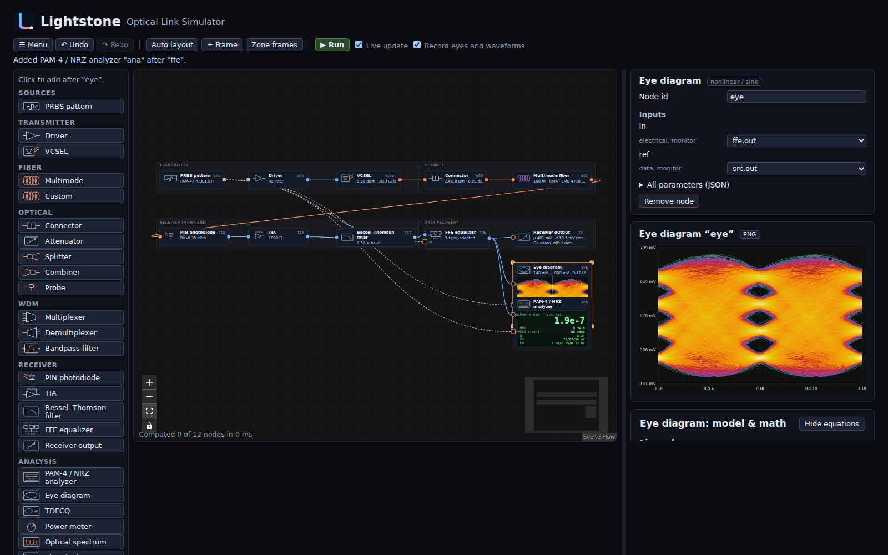
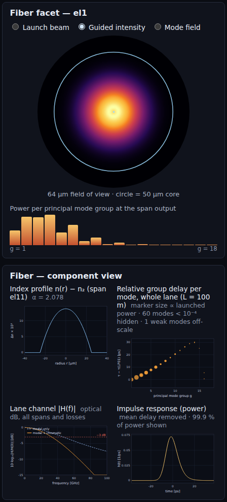
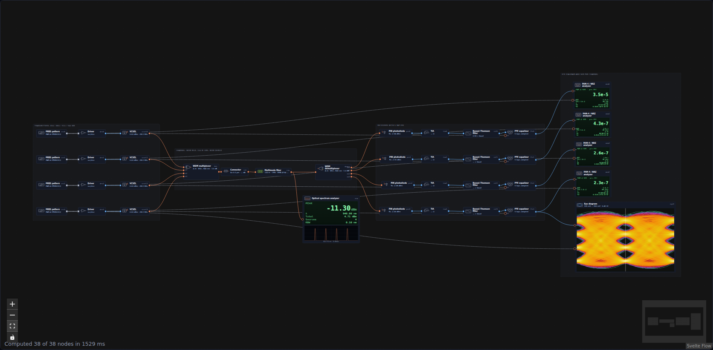

# Lightstone – Optical Link Simulator

**Open-source simulator for short-reach optical links: VCSEL, multimode fiber, PAM-4 receiver.** Build a link from components, see the eye close as you drag the fiber length, and get SER, eye heights and TDECQ in well under a second, in the browser or from Python.



**Try it in the browser:** <https://lightstone-photonics.github.io/lightstone/> – nothing to install, no account; the simulation runs locally in WebAssembly.

## What it does

- **Physics you can check.** Every component has a model document with its equations, symbols, limits and sources ([`docs/model/`](docs/model/)). The fiber is solved mode by mode (scalar LP modes of the real index profile, germania-doped core); the VCSEL launch is coupled into those modes with overlap integrals; the receiver noise (thermal, shot, RIN, jitter) is tracked exactly, so the SER is computed semi-analytically down to 10⁻¹⁵ and below instead of being counted.
- **Validated against public IEEE 802.3 material** ([`docs/validation.md`](docs/validation.md)):
  - NRZ eye closure vs. length agrees with the IEEE 802.3ae 10G link model within 0.2 dB (0–300 m, V14a).
  - PAM-4 TDECQ over worst-case OM4 agrees with the 802.3db fiber emulation within 0.15 dB (V14b).
  - TDECQ agrees with an independent implementation of the 802.3 method; Lightstone is 0.02–0.09 dB conservative (V19).
  - Plus analytic checks of the mode solver, coupling, noise and analysis, and a NumPy reference implementation of the whole chain (V1–V15).
- **A component graph, not a fixed link.** Transmitters, connectors, OM3/OM4/OM5 or custom fibers, attenuators, splitters, combiners, WDM mux/demux and bandpass filters, PIN/TIA, Bessel–Thomson filter, FFE; analyzers for PAM-4/NRZ, eye diagram, TDECQ, power, and optical and electrical spectra. Transmitter jitter (RJ, DCD, SJ with clock recovery) included.
- **Your own components** in Python (as H(f), impulse response, FIR taps, or a nonlinear function on waveforms) or in Rust; see [`docs/model/example-component.md`](docs/model/example-component.md) and [`docs/model/rust-example.md`](docs/model/rust-example.md).
- **Measured waveforms:** load a scope capture and get TDECQ (5-tap reference equalizer, other tap counts, or none) and eye metrics with the same code ([`docs/measured-data.md`](docs/measured-data.md)). Test patterns PRBS13Q and SSPRQ.
- **Runs, sweeps and comparisons** in the editor; graphs and results as JSON, CSV, PNG/SVG. A graph saved in the browser runs unchanged in Python and vice versa.



## What it does not do (yet)

- Single-mode fiber, DFB/EML lasers, 1310/1550 nm, optical amplifiers, coherent links and fiber nonlinearity.
- Measured fibers: the OM3/OM4/OM5 presets are minimum-spec fibers calibrated at 850 nm. Away from 850 nm they are optimistic (V18: OM4 bandwidth +24 % at 918 nm against the TIA worst case), so WDM results at 880–940 nm are too.
- Comparison with measured links. **If you have measured eye diagrams, SER or TDECQ of a multimode link, please open an issue** – that is the most useful contribution right now.

Lightstone is *compared with* IEEE 802.3 and TIA material; it is not certified or endorsed by them. Known limits are listed in [`docs/validation.md`](docs/validation.md), Section 5, and in each component's model document.

## Roadmap

Planned, in this order; the order may change with feedback, and there are no dates:

1. **Measured fibers:** import of measured or worst-case DMD data, which closes the gap away from 850 nm.
2. **Single-mode IM/DD:** single-mode fiber with chromatic dispersion, DFB and EML lasers with chirp, CWDM4 at 1310 nm.
3. **Optical amplifiers:** EDFA, ASE noise, OSNR.
4. **Coherent links:** dual-polarization transmitters and receivers, including polarization multiplexing, with DSP.
5. **Fiber nonlinearity:** Kerr effects with the split-step method.

Missing something for your work, or have data to compare against? [Open an issue](https://github.com/lightstone-photonics/lightstone/issues).



## Python

```bash
pip install lightstone          # Python ≥ 3.10; Linux, macOS, Windows
```

From source (needs Rust): `pip install maturin==1.7.4`, then `(cd crates/lightstone-py && maturin develop --release)`.

```python
import lightstone

g = lightstone.Graph.reference()                  # the reference link: PAM-4, 100 m OM4, 5-tap FFE
g.add("ana", "pam4_analyzer").wire("ffe", "ana").wire("src", "ana.ref")
g.add("tq", "tdecq").wire("el1", "tq").wire("src", "tq.ref")
g.run()
print(g.report("ana")["ser"], g.report("tq")["tdecq_db"])   # ≈ 1.9e-07 (pre-FEC), 3.26 dB

g.set("el1", length=150.0).run()                  # only the nodes after the fiber rerun
print(g.report("ana")["ser"])
```

A custom component is a few lines:

```python
@lightstone.component("rc_filter", inputs={"in": "electrical"}, outputs={"out": "electrical"},
                      linear=True, domain="frequency")
def rc(f, ctx):                                   # describe H(f); the engine applies it to signal and noise
    return 1 / (1 + 1j * f / ctx.params.get("fc", 30e9))

g.insert("ffe", "rc", "rc_filter", fc=25e9).run()
```

All values are SI units unless a key says otherwise (`*_dbm`, `*_db`, `*_db_per_km`, `*_db_hz`). Example graphs are in [`examples/graphs/`](examples/graphs/) (also in the editor's menu; `pam4-100m-om4.json` is the start page); notebooks in [`notebooks/`](notebooks/) (signal tutorial, custom component, sweeps, validation report).

## Documentation

| Document | Content |
|---|---|
| [`tutorial-signals-and-math.md`](docs/tutorial-signals-and-math.md) | Introduction: signals, modes, noise, SER and TDECQ, without prerequisites |
| [`tutorial-reference-link.md`](docs/tutorial-reference-link.md) | The reference link node by node |
| [`tutorial-component-graph.md`](docs/tutorial-component-graph.md) | Python graph API, custom components, the browser editor |
| [`model/`](docs/model/) | One document per component: equations, limits, validation, references |
| [`validation.md`](docs/validation.md) | Validation suite, results and known limitations |
| [`measured-data.md`](docs/measured-data.md) | Analyzing a scope capture: TDECQ (with or without equalizer), eye, PAM-4 metrics |
| [`architecture.md`](docs/architecture.md) | Physical model, engine, signal handling, code structure |
| [`signal-spec.md`](docs/signal-spec.md) | Signal definitions |
| [`references.yaml`](docs/references.yaml) | Every cited standard, contribution and paper |

## Development

```
crates/lightstone-core      physics and graph engine
crates/lightstone-analysis  alignment, eye density, SER/BER, TDECQ, analyzer nodes
crates/lightstone-py        Python bindings and API
crates/lightstone-wasm      WebAssembly bindings for the browser
reference/                  NumPy/SciPy reference implementation (test oracle)
tests/python/               Python validation and API tests
web/                        Svelte 5 browser editor (simulation in a Web Worker)
```

```bash
cargo test -p lightstone-core -p lightstone-analysis --release      # Rust tests
pip install scipy==1.14.1 pytest==8.3.3 && pytest -q tests/python     # Python tests (after maturin develop)
cd web && npm ci && npm run dev                                      # browser editor (needs the wasm32 target,
                                                                     # wasm-bindgen-cli 0.2.130, Node ≥ 22)
npm test && npm run build && DIST=dist npm run e2e                   # web tests (e2e needs Playwright)
```

The web build is fully static and can be hosted on any static file host. It has no backend and no accounts.

## License

Licensed under either of

- Apache License, Version 2.0 ([`LICENSE-APACHE`](LICENSE-APACHE) or <https://www.apache.org/licenses/LICENSE-2.0>)
- MIT license ([`LICENSE-MIT`](LICENSE-MIT) or <https://opensource.org/licenses/MIT>)

at your option.

Unless you explicitly state otherwise, any contribution intentionally submitted for inclusion in this work by you, as defined in the Apache-2.0 license, shall be dual licensed as above, without any additional terms or conditions.
