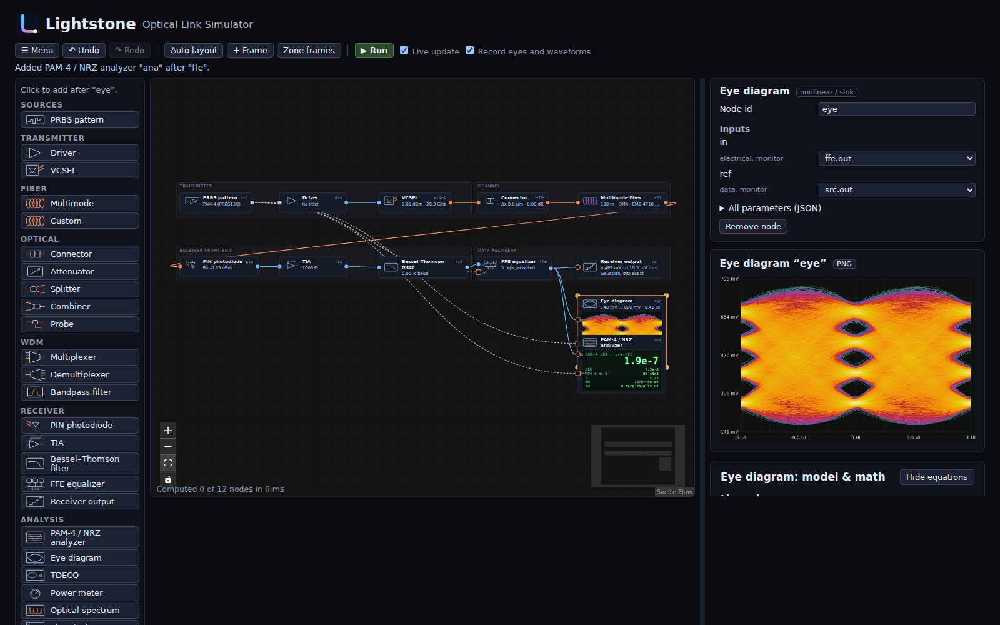

# Lightstone – Optical Link Simulator (Python)

Open-source simulator for short-reach optical links: VCSEL, multimode fiber (OM3/OM4/OM5 or custom), WDM, PIN/TIA receiver with FFE, and PAM-4/NRZ analysis including SER, eye diagrams and TDECQ. The physics core is written in Rust; this package is its Python API.



- **Browser demo** (no install): <https://lightstone-photonics.github.io/lightstone/>
- **Source, documentation and validation:** <https://github.com/lightstone-photonics/lightstone>

```bash
pip install lightstone
```

```python
import lightstone

g = lightstone.Graph.reference()                  # PAM-4 53 GBd, 100 m OM4, 5-tap FFE
g.add("ana", "pam4_analyzer").wire("ffe", "ana").wire("src", "ana.ref")
g.add("tq", "tdecq").wire("el1", "tq").wire("src", "tq.ref")
g.run()
print(g.report("ana")["ser"], g.report("tq")["tdecq_db"])   # ≈ 1.9e-07 (pre-FEC), 3.26 dB
```

Graphs saved in the browser editor load with `lightstone.Graph.from_json(...)`, and your own components can be written in Python (as H(f), impulse response, FIR taps or a nonlinear function on waveforms). Validation against analytic results and public IEEE 802.3 material: [docs/validation.md](https://github.com/lightstone-photonics/lightstone/blob/main/docs/validation.md).

Licensed under MIT OR Apache-2.0.
