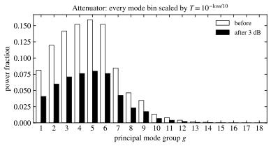

## What it models

A lumped, wavelength-independent optical loss: a variable optical attenuator, a splice, or the insertion loss of a connector placed after a fiber.

## Equations

**Power transmission** (`eq:attenuator`):

$$P_\text{out}(t) = T\thinspace P_\text{in}(t),\qquad T = 10^{-\text{loss}_\text{dB}/10}$$

Here $P_\text{in}(t)$ and $P_\text{out}(t)$ are the optical power (W) at the input and output at time $t$, $T$ is the power transmission (dimensionless, 0 … 1), and $\text{loss}_\text{dB}$ is the attenuation `loss_db` (dB).

The same factor applies to every mode, so the modal power distribution is unchanged.

*Figure 1. Power per mode group before and after a 3 dB attenuator (5 µm offset launch). Every mode bin is scaled by the same factor T = 0.5, so the shape of the distribution, and with it the modal bandwidth, is unchanged. A real mode-selective loss would cut the high groups more strongly; that is not modeled. Generated by `scripts/make_figures.py`.*

## Assumptions & limits

- Mode-independent loss. Real connectors and splices can strip high-order modes (mode-selective loss). That would change the modal bandwidth and is not modeled.
- No reflections and no polarization effects.

## Parameters

| Name | Symbol | Unit | Default | Range |
|---|---|---|---|---|
| `loss_db` | $\text{loss}_\text{dB}$ | dB | 3 | 0 … 30 |

## Validation

- **R3**: an attenuator of X dB gives exactly the same receiver output as X dB of fiber extra loss.
