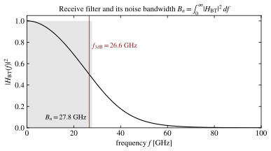

## What it models

The receive filter (node kind `bessel_thomson`): a 4th-order Bessel–Thomson low-pass, the response IEEE 802.3 specifies for the reference receiver of these links. It stands for the bandwidth of the whole receiver. It filters the signal and every noise term at its input alike, which is why the noise at its output is known exactly.

## Equations

**Transfer function** (`eq:rx-bessel-thomson`):

$$H_\text{rx}(f) = \frac{105}{s^4 + 10s^3 + 45s^2 + 105s + 105},\qquad s = j\thinspace\omega_{3}\frac{f}{f_\text{3dB}},\quad \omega_3 \approx 2.1139$$

Here $f$ is the frequency in Hz, $f_\text{3dB}$ the −3 dB frequency of the filter in Hz ($0.5\times$ the symbol rate by default), $s$ the normalized complex frequency and $j$ the imaginary unit. $\omega_3$ is the normalized frequency at which the 4th-order Bessel polynomial is 3 dB down; it places the −3 dB point of $H_\text{rx}$ at $f_\text{3dB}$. With `enabled: false` the filter passes its input unchanged (for validation only).

**Noise bandwidth**: $B_n = \int_0^\infty |H_\text{rx}(f)|^2\thinspace df$ (Hz), evaluated on the grid as $\tfrac{f_s}{2}\thinspace\overline{|H_\text{rx}|^2}$ ($f_s$ the sample rate, the bar the mean over all FFT bins). White noise of one-sided PSD $S$ has variance $S\thinspace B_n$ after the filter. The node reports $B_n$.

**Noise at the output.** The filter multiplies $H_\text{rx}$ into the filter of every noise term. For the reference receiver chain (`pin.md`, `tia.md`) this gives the exact output variance used for the semi-analytic SER:

$$\sigma^2(t) = Z^2\left[i_n^2 B_n + 2q\tfrac{f_s}{2}(g_\text{rx}^2 * I)(t) + \mathrm{RIN}\thinspace R^2\tfrac{f_s}{2}(g_\text{tot}^2 * P_\text{tx}^2)(t)\right]$$

Here $\sigma(t)$ is the standard deviation of the output noise voltage in V, $Z$ the TIA's transimpedance in Ω, $i_n$ its input noise density in A/√Hz, $q$ the elementary charge, $I(t)$ the noiseless photocurrent, RIN the transmitter's relative intensity noise in 1/Hz, $R$ the responsivity of the source and $P_\text{tx}(t)$ the transmitted optical power in W. $f_s$ is the sample rate in Hz (white noise of one-sided PSD $S$ has per-sample variance $S f_s/2$), $*$ the circular convolution over the time grid, and $g_\text{rx}^2$, $g_\text{tot}^2$ the squared samples of the discrete impulse responses of the filter and of channel × filter. The general form for any noise terms is `eq:materialize` (`receiver-output.md`).

*Figure 1. |H_BT(f)|² of the receive filter at the default f_3dB = 0.5 × 53.125 GBd = 26.6 GHz. The shaded rectangle has the same area: the noise bandwidth B_n = 27.8 GHz, slightly above f_3dB. Generated by `scripts/make_figures.py`.*

## Assumptions & limits

- An ideal filter shape. A real receiver's frequency response can replace it with a custom component.
- Linear: no slew-rate or amplitude limits.

## Parameters

| Name | Symbol | Unit | Default | Range |
|---|---|---|---|---|
| `f3db_rel` (lane: `rx.bt_f3db_rel`) | $f_\text{3dB}$ / symbol rate | — | 0.5 | 0.3 … 1.0 |
| `enabled` (lane: `rx.filter_enabled`) | — | — | true | — |

## Validation

- **V9**: the discrete $B_n$ matches the continuous integral to < 0.1 %; with thermal noise only, the output variance is $Z^2 i_n^2 B_n$ to < 1 %.
- **V10**: shot noise of a constant input adds $Z^2\thinspace2qI\thinspace B_n$ to < 1 %.
- Simulated noise (thermal + shot + RIN) matches the analytic σ to < 2 % at 0, 50 and 150 m (Python test).
- **V15**: σ(t) agrees with the NumPy reference.
- **S1** (`electrical-spectrum-analyzer.md`): with thermal noise only, the noise PSD after the filter is 3.010 dB down at $f_\text{3dB}$.
