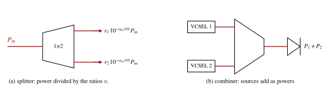

## What it models

A passive optical power combiner (node kind `combiner`): it brings the light of several inputs (`in0` … `inN−1`) into one output, for example several VCSELs into one fiber. Mode- and polarization-independent.

*Figure 1. (b) A combiner joins two sources into one fiber. The lasers are mutually incoherent, so the photodiode sees P₁ + P₂ (`eq:combiner`). (a), for comparison, the splitter (`splitter.md`). Schematic.*

## Equations

**Combiner** (`eq:combiner`), $K$ inputs:

$$P_\text{out}(t) = 10^{-\alpha_\text{ex}/10} \sum_{k=1}^{K} P_k(t)$$

Here $K$ is the number of inputs, $k = 1 \dots K$ counts them, $P_k(t)$ is the optical power (W) at input $k$, $P_\text{out}(t)$ the power at the output, and $\alpha_\text{ex}$ (dB) the combiner's excess loss, applied to every input.

The contributions of the inputs are kept separate on the output. They come from different lasers and are mutually incoherent, so they add as powers at the detector (signal-spec 3.1, 7).

## Assumptions & limits

- Same transmission for all modes and polarizations.
- It does not merge contributions of the **same** source (light that returns to itself, e.g. in a loop). That is a prerequisite for loops (docs/architecture.md, 7.8).
- No phase (`Field` level not modeled yet), no reflections, no wavelength dependence. For wavelength-selective combining see `wdm-mux.md`.

## Parameters

| Name | Symbol | Unit | Default | Range |
|---|---|---|---|---|
| `inputs` | $K$ | — | 2 | ≥ 2 |
| `excess_loss_db` | $\alpha_\text{ex}$ | dB | 0 | ≥ 0 |

## Validation

- Two VCSELs combined into one fiber give the sum of their individually detected powers (to 10⁻¹²).
