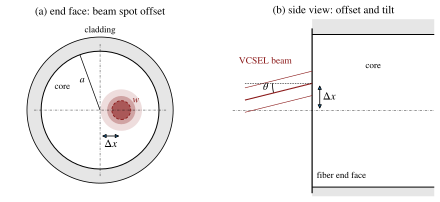
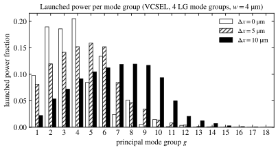

## What it models

The connector (node kind `connector`) holds the fiber end in front of the source or another fiber. It adds its insertion loss to the light at its input and, before the first fiber, sets the launch geometry: a radial offset and a tilt between the beam and the fiber axis. These decide how the light couples into the fiber's guided modes. The coupled power per mode sets the launch condition, which drives modal dispersion further down the link.

*Figure 1. (a) End face: the VCSEL beam spot (radius w) is shifted from the core center by the offset Δx. (b) Side view: offset Δx and tilt θ between the beam axis and the fiber axis, both in the x–z plane. Schematic, not to scale.*

## Equations

**Input**: the source's near field arrives with the optical signal: an incoherent mix of Laguerre–Gauss mode fields $u$ with waist $w$ (`eq:launch-lg`, `vcsel.md`).

**Connector loss**: $T = 10^{-\text{loss}_\text{dB}/10}$ multiplies the power of every contribution. Here $T$ is the power transmission (dimensionless) and $\text{loss}_\text{dB}$ the insertion loss `loss_db` (dB).

**Launch geometry**: before the first fiber the connector records its radial offset $\Delta x$ and tilt $\theta$ on the signal (the last connector before the fiber wins). The overlap with the fiber modes needs those modes, so it is evaluated by the fiber span (`custom-fiber.md`) with the equations below. Between two fibers a connector may only add loss: an offset or tilt there would redistribute power between modes (mode coupling), which is not modeled, so the engine reports an error.

**Overlap integral** (`eq:coupling-overlap`) for every VCSEL mode $u$ and fiber mode $\psi_m$:

$$c_m = \iint u(x - \Delta x, y)\thinspace e^{j k_0 \sin\theta\thinspace x}\thinspace\psi_m(x,y)\thinspace dx\thinspace dy$$

Here $c_m$ is the dimensionless complex amplitude coupled into fiber mode $m$, $u$ the VCSEL mode field (1/m), $\psi_m$ the real, unit-power field (1/m) of fiber mode $m$ in one orientation, and $(x, y)$ the transverse coordinates (m) on the fiber end face, centered on the core. $\Delta x$ is the radial offset (m) along $x$, $\theta$ the tilt (rad), $k_0 = 2\pi/\lambda$ the free-space wavenumber (rad/m) at the wavelength $\lambda$, and $j$ the imaginary unit; $e^{j k_0 \sin\theta\thinspace x}$ is the linear phase of the tilted beam.

**Mode power** (`eq:coupling-power`, `eq:launch-incoherent`):

$$P_m = \frac{1}{N_{u}} \sum_{u} \left(|c_{m,\cos}|^2 + |c_{m,\sin}|^2\right),\qquad P_\text{unguided} = 1 - \sum_m P_m$$

Here $P_m$ is the fraction of the launched power in fiber mode $m$, $N_u$ the number of VCSEL modes (cos and sin orientations counted separately), the sum over $u$ runs over all VCSEL modes, and $c_{m,\cos}$, $c_{m,\sin}$ are the overlaps of $u$ with the cos and sin orientations of fiber mode $m$ (the sin term is zero for modes without azimuthal dependence). $P_\text{unguided}$ is the fraction of power that is not guided.

**Encircled flux** of the guided near field: $EF(\rho) = \sum_m P_m\thinspace\eta_m(\rho) / \sum_m P_m$, where $EF(\rho)$ is the fraction of guided power inside radius $\rho$ (m, here measured from the core center) and $\eta_m(\rho)$ is the fraction of mode $m$'s power inside radius $\rho$.

**Numerics**: polar quadrature on the mode solver's radial grid with an $M$-point azimuthal FFT ($M = 256$). Overlaps are normalized by the discretely integrated input power, so $\sum_m P_m \le 1$ holds exactly.

*Figure 2. Launched power per principal mode group (`eq:coupling-power`, summed over the modes of each group) for offsets of 0, 5 and 10 µm. A centered beam fills mainly groups 1–6. With growing offset the power moves to higher groups, which see larger differential delays: the EMB of the OM4 preset falls from 4710 to 3874 and 2595 MHz·km. Generated by `scripts/make_figures.py`.*

## Assumptions & limits

- Butt coupling at the facet. No Fresnel reflection, no air gap or lens, and no angular aperture of the VCSEL beyond its waist.
- The tilt is applied as a linear phase. Tilt and offset act in the same plane (x–z).
- Between two fibers only the insertion loss is modeled: no offset or tilt (mode coupling), no mode-selective loss and no modal noise.

## Parameters

| Name | Symbol | Unit | Default | Range |
|---|---|---|---|---|
| `offset` (lane: `launch.offset`) | $\Delta x$ | m | 0 | 0 … 25 µ |
| `tilt` (lane: `launch.tilt`) | $\theta$ | rad | 0 | 0 … 0.15 |
| `loss_db` | $\text{loss}_\text{dB}$ | dB | 0 | ≥ 0 |

The beam waist $w$ and the number of VCSEL mode groups $Q$ are VCSEL parameters (`vcsel.md`).

## Validation

- **V4**: coaxial Gaussian on the LP01 mode of a parabolic fiber matches $\eta = \left(\frac{2w_0w_1}{w_0^2 + w_1^2}\right)^2$, $w_1^2 = 2a^2/V$, to < 0.1 %. Here $\eta$ is the coupled power fraction, $w_0$ the Gaussian beam radius (m), $w_1$ the LP01 mode field radius (m), $a$ the core radius (m) and $V$ the fiber's normalized frequency (V number).
- **V5**: $\sum_m P_m \le 1$; an input equal to a mode couples 100 % into that mode.
- **V6**: offsets $+\Delta x$ and $-\Delta x$ give identical mode powers (to 10⁻¹² of the largest mode power).
- Angular quadrature is converged: 256 vs 1024 points agree to 10⁻¹⁰ at 20 µm offset and 0.15 rad tilt.
