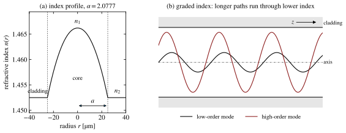
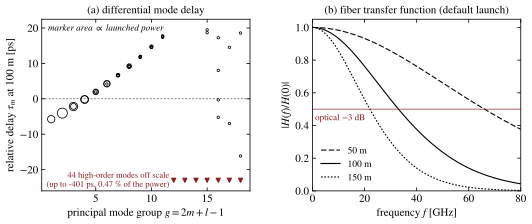

## What it models

A graded-index (or step-index) multimode fiber span with every parameter free (node kind `custom_fiber`, *Custom* in the editor): core radius, NA, index profile, core glass, attenuation and the solver grid. It takes the optical signal at its input, finds which fiber modes carry the light (at the first fiber of a path: the launch from the source's near field and the connector's offset and tilt, `connector.md`), and delays and attenuates each mode over the span length. Differential mode delay (modal dispersion) and chromatic dispersion turn the span into a low-pass filter on the optical power. The output is the same signal with updated mode bins; it stays lazy (`pin.md` evaluates the transfer function).

The default is a germania-doped (GeO₂–SiO₂) core in fused-silica cladding with the values of the OM4 preset. The standard types OM3, OM4 and OM5 are the presets of the `mmf` component (`mmf.md`), which is this model with fixed physics. Graphs saved with the old kind `fiber` load as `custom_fiber`.

*Figure 1. (a) Index profile n(r) of the OM4 preset: n₁ = 1.4662 on the axis, falling almost parabolically (α = 2.078) to n₂ = 1.4525 at the core radius a = 25 µm. (b) Why grading works, in the ray picture: a high-order mode travels a longer path, but through glass of lower index where light is faster, so both arrive nearly together. The remaining differences are the differential mode delay (DMD). Schematic (b) is not to scale.*

## Equations

**Index profile** (power law, `config.Profile`):

$$n^2(r,\lambda) = n_2^2(\lambda) + \left(n_1^2(\lambda) - n_2^2(\lambda)\right)\left(1 - (r/a)^\alpha\right)\ (r < a),\qquad n^2(r,\lambda) = n_2^2(\lambda)\ (r \ge a)$$

equivalently $n^2 = n_1^2\left(1 - 2\Delta(\lambda)(r/a)^\alpha\right)$ with $\Delta(\lambda) = (n_1^2 - n_2^2)/(2n_1^2)$.

Here $n(r,\lambda)$ is the refractive index at radial distance $r$ (m) from the fiber axis and vacuum wavelength $\lambda$ (m). $n_1$ is the index on the axis (core centre), $n_2$ the cladding index, and $a$ the core radius (m). The profile exponent $\alpha$ (dimensionless) sets the shape of the grading: $\alpha = 2$ is parabolic. $\Delta$ is the relative index difference between core centre and cladding.

**Materials** (`core_material`, default `germania_doped`):

- Cladding $n_2(\lambda)$: fused silica, Sellmeier equation (`eq:material-sellmeier`, Malitson 1965).
- Core centre $n_1(\lambda)$: GeO₂–SiO₂ glass with GeO₂ mole fraction $x$ (`eq:material-germania`, Fleming 1984). Its Sellmeier coefficients are interpolated linearly between fused silica and GeO₂ glass, $B_i(x) = B_{i,\mathrm{SiO_2}} + x\thinspace(B_{i,\mathrm{GeO_2}} - B_{i,\mathrm{SiO_2}})$, likewise $C_i$. Here $i = 1, 2, 3$ counts the terms of the three-term Sellmeier equation $n^2 - 1 = \sum_i B_i\lambda^2/(\lambda^2 - C_i^2)$: $B_i$ (dimensionless) is the strength of term $i$ and $C_i$ (µm, with $\lambda$ in µm) its resonance wavelength. The subscripts SiO₂ and GeO₂ mark the coefficients of pure fused silica and pure GeO₂ glass.
- $x$ is fixed by the numerical aperture at 850 nm, $\sqrt{n_1^2 - n_2^2} = NA$, where NA (dimensionless) is the numerical aperture, the sine of the largest acceptance angle: for NA = 0.20, $x$ = 9.2 mol% GeO₂. The graded profile is a graded GeO₂ concentration, so the doped core has its own, stronger dispersion than the cladding.
- Consequence: $\Delta$ and the NA change with wavelength (**profile dispersion**). This shifts the optimum α at 850 nm to ≈ 2.03–2.04, as for real Ge-doped fibers, and raises the chromatic dispersion of the launched modes from −85 (pure silica) to −93 ps/(nm·km) at 850 nm.
- `core_material: "fixed_delta"` restores the model of versions ≤ 0.11: both indices follow fused silica, $\Delta = NA^2/(2n_1^2)$ is held constant (NA at the source wavelength), optimum α ≈ 1.98.

**Scalar mode equation** (`eq:modes-radial`) for $\psi = F(r)\lbrace\cos,\sin\rbrace(l\varphi)$:

$$F'' + \frac{F'}{r} + \left(k_0^2 n^2(r) - \frac{l^2}{r^2}\right)F = \beta^2 F$$

Here $\psi$ is the scalar transverse field of a mode, $\varphi$ the azimuthal angle around the axis, and $F(r)$ the radial field profile; $F'$ and $F''$ are its first and second derivatives with respect to $r$. The integer $l = 0, 1, 2, \dots$ is the azimuthal order of the LP mode. $k_0 = 2\pi/\lambda$ is the vacuum wavenumber (1/m), and the eigenvalue $\beta$ is the propagation constant of the mode along the fiber (1/m).

This is solved by cell-centered finite volumes (600 points per core radius, domain $2a$). The result is a symmetric tridiagonal eigenproblem, solved with Sturm-sequence bisection and inverse iteration. Guided modes have $\beta > k_0 n_2$.

**Group delay and chromatic slope** per mode, from 5-point finite differences of $n_\text{eff}(\lambda)$ ($\delta\lambda = 4$ nm):

$$\tau_m = \frac{1}{c}\left(n_\text{eff} - \lambda\frac{dn_\text{eff}}{d\lambda}\right),\qquad \frac{d\tau_m}{d\lambda} = -\frac{\lambda}{c}\frac{d^2 n_\text{eff}}{d\lambda^2}$$

Here $m$ numbers the guided LP modes and $\tau_m$ is the group delay of mode $m$ per unit fiber length (s/m); a span of length $L$ (m) delays it by $\tau_m L$. $n_\text{eff} = \beta/k_0$ is the effective index of the mode, $c$ the speed of light in vacuum (m/s), and $\lambda$ the source wavelength. The second formula is the chromatic delay slope (s/m²): how fast the mode's delay per length changes with wavelength. $\delta\lambda$ is the wavelength step between the five points of the finite-difference stencil.

**Power propagation** (`eq:fiber-power-propagation`). The VCSEL coherence time (~ps) is shorter than the delay spread, so intermodal interference averages out and the fiber is linear in power:

$$H(f) = \sum_m w_m\thinspace e^{-j2\pi f(\tau_m - \bar\tau)L}\thinspace e^{-2\pi^2 f^2\sigma_m^2},\qquad \sigma_m = \left|\frac{d\tau_m}{d\lambda}\right| L\thinspace\sigma_\lambda$$

$$w_m = P_m\thinspace\eta_m\thinspace10^{-\alpha_\text{dB}(\lambda)\thinspace L/(10 \cdot 1000\thinspace\text{m})}\thinspace10^{-\text{loss}_\text{dB}/10}$$

Here $H(f)$ is the transfer function of the fiber on optical power (dimensionless) at modulation frequency $f$ (Hz), and $j$ is the imaginary unit. $w_m$ is the power weight of mode $m$ at the detector. $\tau_m$ is the group delay per unit length of mode $m$ (s/m, above), so $(\tau_m - \bar\tau)L$ is the mode's delay relative to the mean. $\sigma_m$ is the RMS chromatic broadening of mode $m$ (s) and $\sigma_\lambda$ the RMS spectral width of the source (m). $P_m$ is the fraction of the source power launched into mode $m$, $\alpha_\text{dB}(\lambda)$ the fiber attenuation at the source wavelength (dB/km, `eq:fiber-attenuation`; $L$ in m), and $\text{loss}_\text{dB}$ the lumped extra loss `extra_loss_db` (dB). $\eta_m$ is the detector-area fraction (1 for full collection), and $\bar\tau$ is the power-weighted mean delay.

**Modal bandwidth** (`eq:fiber-modal-bandwidth`): the −3 dB optical bandwidth $|H(f)/H(0)| = \tfrac12$ of the modal part of the channel at $L$ = 1 km. With equal power in all modes this is the overfilled-launch (OFL) bandwidth; with the actual launch it approximates the effective modal bandwidth (EMB).

**How the EMB is computed, step by step** (`component.rs` → `fiber::modal_bandwidth_length` → `FiberChannel::bandwidth`):

1. **Modes.** The mode solver finds all guided LP modes at the source wavelength (90 at 850 nm for the OM4 preset). Each mode $m$ gets its group delay per length $\tau_m$.
2. **Launch weights.** The overlap of the VCSEL near field with every mode gives the launched power fraction $P_m$; with full collection, no attenuation and no extra loss the weight is $w_m = P_m$. With the defaults the near field is an equal mix of the 4 lowest Laguerre–Gauss mode groups with a 4 µm waist, centred on the core (connector offset 0, tilt 0). About 90 % of the power then lands in mode groups 1–6.
3. **Transfer function at 1 km**, without attenuation and without chromatic dispersion (spectral width 0), so only modal delay counts:
   $$H(f) = \sum_m w_m\thinspace e^{-j2\pi f(\tau_m - \bar\tau)L},\qquad L = 1\ \text{km},\quad \bar\tau = \text{power-weighted mean delay}$$
   Each mode is a delayed copy of the input; their sum acts as a low-pass filter.
4. **−3 dB point.** The lowest frequency with $|H(f)/H(0)| = \tfrac12$ (optical −3 dB, the fiber-bandwidth convention, since $H$ acts on optical power): a scan up to 50/(delay spread), then 80 bisection steps.
5. **Bandwidth × length.** For pure delays the bandwidth scales exactly as $1/L$, so $B \cdot 1\ \text{km}$ in MHz·km does not depend on the reference length. Here $B$ is the −3 dB bandwidth found in step 4 at $L$ = 1 km.

The result is the `emb_length` of the fiber report. It depends on the launch: with an 8 µm connector offset, the OM4 preset drops from 4710 to about 3070 MHz·km, because more power goes into higher-order modes. The OFL bandwidth uses the same steps with equal power in every spatial mode (1454 MHz·km for the OM4 preset).

**Difference to the standard's EMB.** The standard measures DMD (differential mode delay) by scanning a small single-mode probe spot across the core, roughly 0–24 µm from the centre, and records the pulse delay at each radial position (TIA-455-220). It combines these measurements with a fixed set of about ten reference weightings, each representing a different compliant VCSEL launch (from centre-heavy to spread-out, within the encircled-flux limits). It computes a bandwidth for each and takes the **worst**; that minimum, scaled by a fixed factor (about 1.13), is the fiber's EMB. So:

| | Standard EMB | Lightstone `emb_length` |
|---|---|---|
| Launch | worst of ≈ 10 reference launches | one launch: the actual source (default VCSEL, centred) |
| Fiber | measured DMD of a real fiber | modes of an ideal power-law profile |
| Means | guaranteed for any compliant laser | bandwidth for this source and this fiber model |
| Computation | from DMD-derived pulse responses | exact transfer function of the mode delays (equivalent for the same delays and weights) |

At 850 nm the calibration makes both equal. At other wavelengths they diverge: the worst reference launch can be a different one, and real worst-case fibers have DMD patterns (an index dip on the axis, distortions near the core edge, outer modes early and inner modes late) that a single α cannot produce. Those fibers just pass at 850 nm but degrade faster at longer wavelengths. This is why the `mmf` presets are optimistic away from 850 nm (V18, `mmf.md`). A measured or worst-case DMD import would fix both points: realistic delays per radius and wavelength, and the EMB computed as the standard does (worst over the reference launches). The single-launch EMB would remain as "the bandwidth for your actual source".

**Attenuation** (`eq:fiber-attenuation`): $T = 10^{-\alpha_\text{dB/km}(\lambda)\thinspace L/(10 \cdot 1000\thinspace\text{m})}$, evaluated at each source's wavelength. Here $T$ is the power transmission of the fiber (dimensionless), $\alpha_\text{dB/km}(\lambda)$ the attenuation in dB/km at wavelength $\lambda$ (the $\alpha(\lambda)$ of the next equation), and $L$ the fiber length in m.

**Attenuation spectrum** (`eq:fiber-attenuation-spectrum`, since v0.16; `attenuation_spectrum: "rayleigh"`, default). `attenuation_db_per_km` is the value at 850 nm. A share $f_R$ scales like Rayleigh scattering, the rest is wavelength-independent:

$$\alpha(\lambda) = \alpha_{850}\left[1 + f_R\left(\left(\frac{850\ \text{nm}}{\lambda}\right)^4 - 1\right)\right],\qquad f_R = 0.6355$$

Here $\alpha(\lambda)$ is the attenuation (dB/km) at wavelength $\lambda$, $\alpha_{850}$ the attenuation at 850 nm (dB/km), and $f_R$ (dimensionless) the share of the 850 nm attenuation due to Rayleigh scattering.

$f_R$ is fixed by the OM5 cabled limits of TIA-568.3-D, 3.0 dB/km at 850 nm and 2.3 dB/km at 953 nm. The same formula then predicts 1.44 dB/km at 1300 nm against the limit 1.5. At 850 nm the value is exactly `attenuation_db_per_km`. `"flat"` keeps the attenuation the same at every wavelength, as before v0.16. At 3.5 dB/km: 3.21 dB/km at 880 nm, 2.97 at 910 nm, 2.76 at 940 nm.

*Figure 2. OM4 preset. (a) Relative group delay of the 90 LP modes after 100 m, marker area proportional to the power launched by the default VCSEL. The excited modes lie between −6 and +18 ps (over-compensated: higher groups arrive later). Forty-four high-order modes in groups 12–18 lie more than 20 ps away and are drawn off scale: they arrive up to 401 ps early but carry only 0.5 % of the power. (b) The resulting transfer function on optical power (`eq:fiber-power-propagation`): optical −3 dB bandwidth 66 GHz at 50 m, 33.0 GHz at 100 m and 22.0 GHz at 150 m, which is roughly 1/L. The 100 m value is checked against the simulator's channel bandwidth. Generated by `scripts/make_figures.py`.*

## Assumptions & limits

- Scalar, weakly guiding LP modes. No polarization effects, no vector corrections.
- **Chromatic dispersion** of the launched modes at 844 nm is ≈ −95.5 ps/(nm·km). The IEEE 802.3 MMF value (zero-dispersion wavelength U₀ = 1328 nm, dispersion slope at U₀ S₀ = 0.093477 ps/(nm²·km), from measured fibers) is −101 ps/(nm·km), about 6 % more. Possible reasons: real cores have a higher or non-uniform GeO₂ content, or other dopants; the linear interpolation of Sellmeier coefficients is approximate. At 100 m and 0.6 nm RMS width this makes TDECQ 0.1–0.3 dB optimistic (V14b; pure silica, ≤ v0.11: 0.4–0.6 dB).
- No mode coupling along the fiber, no bends, and the same attenuation for all modes. Per-mode loss and a tabulated-mode fiber (for measured DMD data, hollow-core and multicore fibers) are planned.
- The GeO₂ concentration follows the index profile exactly (the shape $1 - (r/a)^\alpha$ is the same at every wavelength); no central dip, no index trench, no fluorine-doped cladding.
- The chromatic broadening of each mode is Gaussian for a Gaussian source spectrum. Correlation between VCSEL transverse modes and their wavelengths is not modeled.
- Modes very close to cutoff are kept if they are guided at all five wavelengths of the finite-difference stencil.

## Parameters

In a lane configuration the same keys are under `fiber.`.

| Name | Symbol | Unit | Default (OM4) | Range |
|---|---|---|---|---|
| `length` | $L$ | m | 100 | 0 … 500 |
| `core_radius` | $a$ | m | 25 µ | 2 … 50 µ |
| `na` | NA | — | 0.20 (at 850 nm) | 0.08 … 0.30 |
| `profile` | — | — | `{kind: "graded", alpha: 2.0777}` | `graded` (α 1.9 … 2.2) or `step` |
| `core_material` | — | — | `germania_doped` | `germania_doped`, `fixed_delta` |
| `attenuation_db_per_km` | $\alpha_{850}$ | dB/km | 3.5 (at 850 nm) | ≥ 0 |
| `attenuation_spectrum` | — | — | `rayleigh` | `rayleigh`, `flat` |
| `extra_loss_db` | $\text{loss}_\text{dB}$ | dB | 0 | 0 … 3 |
| `grid_points_per_radius` | — | — | 600 | 300 … 1200 |
| `domain_factor` | — | × a | 2.0 | 1.5 … 3 |

## Validation

- **V1**: step-index fiber with $V = 4.5$, where $V = k_0 a\thinspace NA$ is the normalized frequency (dimensionless). $n_\text{eff}$ of LP01/11/21/02 matches the analytic Bessel eigenvalue equation to < 10⁻⁶.
- **V2**: parabolic profile. Mode-group eigenvalues $\beta^2 = k^2n_1^2 - 2kn_1\sqrt{2\Delta}\thinspace g/a$ match to < 10⁻⁵, and group $g$ contains $\lceil g/2\rceil$ LP labels. Here $k = k_0$ is the vacuum wavenumber, $g = 1, 2, \dots$ the principal mode group number, and $\lceil\cdot\rceil$ rounds up to the next integer.
- **V3**: modes are orthonormal to < 10⁻⁶.
- **V7**: a two-mode link with known Δτ (difference of the two modes' group delays per length, s/m) shows two peaks separated by $\Delta\tau L$ to < 0.1 ps.
- Material unit tests: n(GeO₂ glass, 850 nm) = 1.597 (Fleming); NA 0.20 at 850 nm needs 9.2 mol% GeO₂; the doped core has more dispersion and a longer zero-dispersion wavelength than silica. The NumPy reference implements the same model independently (V15).
- Grid convergence: differential delays at 600 and 1200 points per radius agree within 1 % of the delay spread.
- **V14b**: PAM-4 at 53.125 GBd over worst-case OM4 (EMB ≈ 4700 MHz·km, 50 and 100 m): TDECQ through this fiber equals TDECQ through a Gaussian filter of the same bandwidth within 0.08 dB, and agrees with the IEEE 802.3db fiber emulation (Table 167-12) within 0.15 dB when the chromatic dispersion is matched, and within 0.30 dB with this model's own dispersion (docs/validation.md, Section 3).
- **V14a**: NRZ eye closure vs. length (0–300 m, 10.3125 GBd, EMB ≈ 2000 MHz·km, two index profiles) agrees with the IEEE 802.3ae link model within 0.2 dB when the link model gets this model's EMB, dispersion and rise times (docs/validation.md, Section 2). The launched modes' dispersion (≈ −97 ps/(nm·km) at 840 nm) is smaller than the 802.3ae worst-case fiber value (−118 ps/(nm·km)).
- **V15**: modes, coupling and channel agree with the NumPy/SciPy reference.
