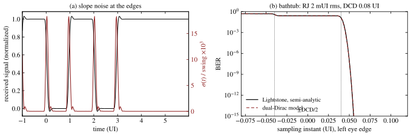

## What it models

The electrical driver between the pattern source and the laser (node kind `driver`): in hardware a DAC or PAM-4 driver IC. It turns the symbols (`prbs-pattern.md`) into a normalized drive waveform, one constant level per symbol, which the VCSEL converts to optical power (`vcsel.md`). Its imperfections are timing errors of the edges, transmitter jitter, which it can add optionally. The jitter model is the hybrid one of the IEEE dual-Dirac methodology:

- **Deterministic jitter (DJ)** shifts each edge explicitly. Two kinds: duty-cycle distortion (DCD) and sinusoidal jitter (SJ). Both are bounded and repeat with the pattern, so one realization is exact.
- **Random jitter (RJ)** is Gaussian and independent per edge. It is carried as an equivalent noise term whose strength follows the slope of the drive, so the semi-analytic SER stays valid with its Gaussian tails.

Pattern-dependent jitter needs no parameter: it already comes from the bandwidth limits of the VCSEL, fiber and receiver.

## Equations

**Drive levels**: symbol $k$ is mapped to the normalized drive level

$$L_k = \frac{k}{M-1},\qquad k = 0 \dots M-1$$

Here $k$ is the symbol value and $M$ the number of levels (4 for PAM-4: 0, ⅓, ⅔, 1; 2 for NRZ: 0, 1). The levels are exactly equally spaced; the VCSEL maps 0 to its lowest and 1 to its highest optical power. The driver output carries $M$, so the VCSEL can report its levels.

**Drive waveform** (`eq:tx-nrz`): the continuous NRZ-hold waveform

$$d(t) = \sum_n L_{k_n}\,\mathrm{rect}\!\left(\frac{t}{T} - n - \tfrac12\right)$$

is represented by its exact spectrum on the simulation grid,

$$X(f) = S(f)\,T\,\mathrm{sinc}(fT)\,e^{-j\pi fT}$$

Here $d(t)$ is the normalized drive (dimensionless) at time $t$ (s), $n$ the symbol index, $k_n$ the symbol value of symbol $n$, $T$ the symbol period (s; 1/baud), and $\mathrm{rect}$ the unit rectangle (1 inside $\pm\tfrac12$, 0 outside), so symbol $n$ holds its level from $nT$ to $(n+1)T$. $S$ is the DFT of the symbol levels $L_{k_n}$ (periodic in $f$ with period $1/T$), $X(f)$ the spectrum of the drive at frequency $f$ (Hz, the FFT bins of the grid), $\mathrm{sinc}(x) = \sin(\pi x)/(\pi x)$ the spectrum of one rectangular symbol, $e^{-j\pi fT}$ the delay by $T/2$ that puts symbol $n$ at $nT \dots (n+1)T$, and $j$ the imaginary unit.

This is the alias-free sampled version of the continuous drive: results do not depend on the oversampling factor (8 vs 16 vs 32 samples/UI change TDECQ by < 0.002 dB without RIN; measured during development, not a CI test). The drive has no rise time of its own; the band-limited rectangle overshoots its levels by about 9 % at each edge (Gibbs ripple), which the VCSEL response removes. Rise times come from the VCSEL, the fiber and the receiver.

**Edge shifts** (`eq:tx-jitter`). The edge into symbol $n$, with step $\Delta_n = L_{k_n} - L_{k_{n-1}}$, moves by

$$\tau_n = -\operatorname{sign}(\Delta_n)\,\frac{\mathrm{DCD}}{2} + A_\text{SJ}\,\lvert H_\text{J}(f_\text{SJ})\rvert\,\sin\!\big(2\pi f_\text{SJ}\,nT + \arg H_\text{J}(f_\text{SJ})\big),\qquad H_\text{J}(f) = \frac{jf}{f_c + jf}$$

Here $\Delta_n$ is the dimensionless level step at the edge into symbol $n$; $\operatorname{sign}(\Delta_n)$ is $+1$ for a rising and $-1$ for a falling edge. $\tau_n$ is the time shift of the edge (s, negative = early), DCD the duty-cycle distortion (s, peak-to-peak), $A_\text{SJ}$ the SJ peak amplitude (s), $f_\text{SJ}$ the SJ frequency (Hz), $T = 1/f_\text{baud}$ the symbol period (s) with symbol rate $f_\text{baud}$ (Bd), $f$ the jitter frequency (Hz) and $j$ the imaginary unit. $\lvert H_\text{J}\rvert$ and $\arg H_\text{J}$ scale and phase-shift the SJ.

Rising edges come DCD/2 early and falling edges DCD/2 late, so high pulses are DCD longer and low pulses DCD shorter. DCD is the peak-to-peak value, the DJ(δδ) of the dual-Dirac model. $H_\text{J}$ is the jitter transfer of a first-order clock recovery with corner $f_c$ (`cdr_corner`, default 4 MHz as for the 802.3 reference CRU): slow SJ is tracked out, so the waveform is referenced to the recovered clock. $f_\text{SJ}$ is rounded to a multiple of the record's frequency resolution $1/(N_\text{sym}T)$, with $N_\text{sym}$ the number of symbols in the record (6.49 MHz for one PRBS13Q period at 53.125 GBd), so the jitter is periodic on the grid; the driver warns when it rounds.

**Exact edge-shift spectrum** (`eq:tx-edge-shift`). The drive is a sum of steps, $x(t) = x_0 + \sum_e \Delta_e\,u(t - t_e)$. Here $e$ runs over the edges (symbol boundaries with a level change), $\Delta_e$ is the step of edge $e$, $t_e$ its shifted time (s), $u$ the unit step function, and $x_0$ the constant drive level the steps start from. On the periodic grid each step contributes $\Delta_e\,e^{-j\theta_k p_e}/(j\theta_k)$ with $\theta_k = 2\pi\tilde k/N$ and $p_e$ its position in samples. $k$ is the FFT bin (here not a symbol value), $\tilde k$ its signed frequency index ($-N/2 \dots N/2$), $N$ the number of samples in the record ($N_\text{sym}$ times `sps`), and $\theta_k$ the bin's angular frequency (rad/sample). The phase factor is split into the nearest sample $q_e$ (an FFT of an impulse train) and a remainder $|r_e| \le \tfrac12$:

$$X_k = \frac{1}{j\theta_k}\sum_{m\ge 0}\frac{(-j\theta_k)^m}{m!}\,\mathrm{FFT}\Big[\sum_e \Delta_e\,r_e^m\,\delta_{q_e}\Big]_k,\qquad X_0 = \text{sps}\Big(\sum_n L_{k_n} - \sum_e \Delta_e\,\frac{\tau_e}{T}\Big)$$

Here $X_k$ is bin $k \ne 0$ of the drive spectrum and $X_0$ its DC bin, $m$ the order of the Taylor series of $e^{-j\theta_k r_e}$, $r_e = p_e - q_e$ (samples), $\delta_{q_e}$ a unit impulse at sample $q_e$, $\mathrm{FFT}[\cdot]_k$ bin $k$ of the FFT, sps the samples per UI, and $\tau_e/T$ the shift of edge $e$ in UI ($\tau_e$ is the $\tau_n$ of that edge, in s).

$|\theta_k r_e| \le \pi/2$, so the series is truncated below $10^{-17}$ (about 20 FFTs). The result is alias-free like the unshifted drive and equals it for $\tau \equiv 0$. Without DJ the driver uses the unshifted spectrum unchanged.

**Random jitter as slope noise** (`eq:tx-jitter`). An edge shifted by a small Gaussian $\tau_e$ ($\sigma_\text{RJ}$) differs from the unshifted one by $-\Delta_e\tau_e\,\delta(t - t_e)$ to first order, where $\sigma_\text{RJ}$ is the RMS random jitter (s) and $\delta$ the Dirac impulse. The driver emits this as one noise term: a band-limited impulse at each edge's exact position with weight $a_e = \Delta_e\,\sigma_\text{RJ}/\Delta t$ and strength $S_e = 2a_e^2/f_s$. Here $a_e$ is the dimensionless RMS sample value of the impulse, $\Delta t = 1/f_s$ the sample spacing (s), $f_s$ the sample rate (Hz), and $S_e$ the one-sided noise PSD (1/Hz) it carries. Like RIN, the term passes VCSEL, fiber and receiver filter with exact noise bookkeeping (signal-spec 5):

$$\sigma_\text{J}^2(t) = \sigma_\text{RJ}^2\sum_e \Delta_e^2\,h^2(t - t_e)$$

$\sigma_\text{J}^2(t)$ is the variance of the resulting noise at the receiver at time $t$, and $h$ is the impulse response from the drive to the receiver. The noise is zero between edges and peaks at the edges (Figure 1a). The realization is drawn from the driver's own seed, so RIN, shot and thermal noise keep their random streams.

*Figure 1. Fast 10.3125 GBd NRZ link (VCSEL f_r = 50 GHz, receive filter 4 × baud, no other noise) with RJ = 2 mUI RMS and DCD = 0.08 UI. (a) Received waveform and the slope noise σ(t): zero between edges, largest at the steepest point. (b) Semi-analytic BER vs sampling instant at the left eye edge, on top of the dual-Dirac model (validation V16b). The two plateaus are the late and early edges ±DCD/2. Generated by `scripts/make_figures.py`.*

## Where jitter counts

| Quantity | TX DJ (DCD, SJ) | TX RJ |
|---|---|---|
| Semi-analytic SER | yes (waveform) | yes (σ(t)) |
| Noisy waveform, counted SER, eye height/width, eye diagram | yes | yes (realization) |
| TDECQ | yes | yes (reference-receiver waveform, like RIN) |

Jitter of the receiver's sampling clock is not part of the driver: it is an option of the PAM-4/NRZ analyzer (`pam4-analysis.md`).

## Assumptions & limits

- **First-order RJ.** The slope-noise model is exact for $\sigma_\text{RJ} \ll$ the edge rise time. The error grows with $Q\sigma_\text{RJ}$ relative to the rise time, where $Q$ is the Gaussian tail factor of the target BER (about 7 at 10⁻¹²): at 10.3125 GBd on the fast link of V16b, the 10⁻¹² eye width is within 0.4 σ of the dual-Dirac value for σ = 0.19 ps and within 1.2 σ for σ = 0.39 ps. The driver warns above 0.05 UI RMS. Edge shifts larger than this belong in DJ.
- **Clock recovery.** It reduces SJ only. For white RJ the high-pass removes about $\pi f_c/f_\text{baud} \approx 2.4 \cdot 10^{-4}$ of the variance and is neglected (jitter of independent edges is white up to $f_\text{baud}/2$; the first-order high-pass with corner $f_c$ removes $\int_0^{f_\text{baud}/2} f_c^2/(f^2 + f_c^2)\,df \approx \pi f_c/2$ of that band). DCD is locked to the pattern and has no low-frequency content for a balanced PRBS.
- **Edges must not cross.** DCD plus SJ larger than the edge spacing (about 1 UI) is rejected.
- Not modeled: bounded uncorrelated jitter, spread-spectrum clocking, and the jitter tolerance test with a CDR in the loop.
- The drive itself is ideal: no driver bandwidth, no level mismatch or nonlinearity of the PAM-4 levels.

## Parameters

Driver (`driver` node; `tx.jitter` in `LinkConfig`):

| Name | Symbol | Unit | Default | Range |
|---|---|---|---|---|
| `rj_rms` | $\sigma_\text{RJ}$ | s | 0 | 0 … 2 ps |
| `dcd` | DCD | s (peak-to-peak) | 0 | 0 … 20 ps |
| `sj_amplitude` | $A_\text{SJ}$ | s (peak) | 0 | 0 … 20 ps |
| `sj_frequency` | $f_\text{SJ}$ | Hz | 100 MHz | 1 MHz … baud/2 |
| `cdr_corner` | $f_c$ | Hz | 4 MHz | 0 (off) … 20 MHz |
| `seed` | — | — | from the node | — |

**Reference link (OM4 preset, 53.125 GBd PAM-4).** TDECQ at 100 m without jitter is 3.26 dB.

| Jitter | TDECQ, 100 m |
|---|---|
| none | 3.26 dB |
| RJ 0.2 ps | 3.31 dB |
| RJ 0.4 ps | 3.52 dB |
| DCD 2 ps | 3.53 dB |
| SJ 1 ps @ 100 MHz | 4.55 dB |
| SJ 1 ps @ 6.5 MHz (CDR 4 MHz) | 4.13 dB |

## Validation

- Unit tests (`tx.rs`): the drive spectrum has the exact DC value and the levels at mid-symbol; zero edge shift equals the rectangular drive, a uniform fractional shift is a pure delay (both to 10⁻¹²), and DCD moves the mean and the crossings exactly.
- **V15**: the NumPy reference builds the same drive; the transmitter waveforms agree to < 10⁻⁹.
- **V16a** (Rust, `graph_tests.rs`): the receiver σ(t) of RJ = 0.3 ps at 53.125 GBd PAM-4 matches the variance over 24 Monte Carlo realizations of exact random edge shifts through the same VCSEL and receive filter. It agrees within 0.8 % at every phase of the UI, with and without DCD. The engine's own realization has the predicted variance (0.996 over six seeds).
- **V16b** (Python, `test_v16_jitter.py`): bathtub of a fast NRZ link with RJ = 2 mUI and DCD = 0.08 UI against the dual-Dirac model (Keysight 5989-3206EN). The eye width agrees within 0.5 σ at BER 10⁻³ … 10⁻¹², i.e. TJ = DJ + 2·Q·σ_RJ (TJ is the total peak-to-peak jitter at the BER, DJ the dual-Dirac deterministic jitter).
- **V14c** (Python, `test_v14_ieee_link_model.py`): VECP with DCD of 5 and 10 ps on the 10GBASE-SR-like link of V14a, at 0–300 m. The 10G link model spreadsheet narrows *both* isolated pulses to T − DCD (conservative). With the physical widths T ± DCD, the same Gaussian eye model agrees with Lightstone within the V14a tolerance, and the DCD increment agrees within 0.02 dB (e.g. +0.058 vs +0.052 dB at 100 m, 10 ps). Lightstone stays below the spreadsheet value.
