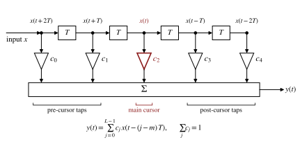
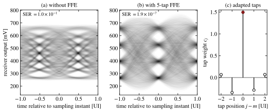

## What it models

A T-spaced feed-forward equalizer in the receiver, after the receive filter. It undoes part of the intersymbol interference (ISI) from the VCSEL bandwidth and the fiber's modal and chromatic dispersion. The taps are adapted once on the received signal and then held fixed, so the equalizer is a **linear filter**: the noise passes it exactly, and the semi-analytic SER stays valid. Graph node kind: `ffe`, inputs `in` (electrical) and `ref` (transmitted symbols), output `out`.

Since v0.15 the reference link includes it: `rxf → ffe → rx`, 5 taps (`rx.ffe_taps` in a lane configuration; 0 removes it), as in the 802.3 reference receiver used for TDECQ. The receiver output, `simulate()` and the browser's reference graph therefore show the equalized signal; at 100 m the SER is 1.9 × 10⁻⁷ instead of 0.10. The NRZ validations against the IEEE link model (V14a, V14c, V16b) and the NumPy cross-check (V15) run without it. The component lives in the core crate (`lightstone_core::ffe`), because the reference lane is built there.

*Figure 1. Tapped delay line of a 5-tap FFE with main cursor m = 2. The labels above the pick-offs give the signal at each tap when the output is y(t): pre-cursor taps see later symbols, post-cursor taps earlier ones.*

## Equations

**Filter** (`eq:ffe`): tap $c_j$ acts at delay $(j - m)\,T$, with $m$ the main cursor and $T$ the symbol period:

$$y(t) = \sum_{i=0}^{L-1} c_i\, x\big(t - (i - m)T\big),\qquad H_\text{FFE}(f) = \sum_{i} c_i\, e^{-j2\pi f (i-m)T}$$

Here $x(t)$ is the input and $y(t)$ the output waveform, $L$ the number of taps, $i = 0, \dots, L-1$ the tap index and $c_i$ the dimensionless weight of tap $i$. The main cursor $m$ is the index of the tap with zero delay, and $T$ is in s. $H_\text{FFE}(f)$ is the equalizer's transfer function at frequency $f$ in Hz, and $j$ in its exponent is the imaginary unit.

**Adaptation** (`eq:ffe-mmse`), constrained minimum mean-square error. With the noiseless symbol-rate samples $x_n$ at sampling phase $\varphi$ (a fraction of the symbol period), the targets $t_n = \bar x + \mathrm{OMA}\,(k_n - 1.5)/3$ (ideal PAM-4 levels at the input's mean $\bar x$ and outer modulation amplitude) and the noise autocorrelation $R_\ell$ at lags $\ell T$:

$$\min_{c}\ \frac{1}{N}\sum_n\Big(\sum_j c_j\,x_{n+m-j} - t_n\Big)^2 + \sum_{i,j} c_i c_j R_{|i-j|}\qquad\text{subject to}\qquad \sum_j c_j = 1$$

Here the minimum is taken over the taps $c_0, \dots, c_{L-1}$. $n = 0, \dots, N-1$ is the symbol index over the $N$ symbols of the pattern period, $k_n$ (0, 1, 2 or 3) the transmitted symbol $n$, and $\sum_j c_j\,x_{n+m-j}$ the equalizer output at symbol $n$. $i$ and $j$ are tap indices, and $\ell = |i - j|$ is the lag in symbols. $x_n$, $t_n$, $\bar x$ and OMA are in the signal's unit (V at the receiver), $R_\ell$ in its square.

The first term is the residual ISI, the second the noise after the equalizer (noise enhancement). The constraint keeps the DC gain, so the levels keep their scale. The phase $\varphi$ is the center of the range of phases with the lowest error (searched over `phases_per_ui` phases). Without the noise term (`noise_aware = false`) this is the same design as the TDECQ reference equalizer (`docs/model/tdecq.md`).

**Noise autocorrelation**: from the signal's noise description (signal-spec 5), time-averaged, $R_\ell = \sum_\text{terms} g^2 \tfrac{f_s}{2}\,\bar S\,(h \star h)(\ell T)$. The sum runs over the signal's noise terms. For each term, $g$ is its gain and $h$ the discrete impulse response of the filters it has passed since generation, $\bar S$ its one-sided PSD at generation averaged over time, and $f_s$ the sampling rate in Hz. $\star$ is the circular autocorrelation over the time grid, taken at the lag $\ell T$. Noise after a nonlinear block, which is carried only as an explicit realization, enters through its periodogram.

*Figure 2. Reference link at 100 m (16 samples/UI), receiver output. (a) Without equalization the eye is closed by intersymbol interference: eye heights −43 to −53 mV, SER 1.0 × 10⁻¹. (b) After the adaptive 5-tap FFE: eye heights 78, 71 and 61 mV, SER 1.9 × 10⁻⁷. (c) The adapted taps: a main tap above 1 and negative neighbors, which subtract the energy that leaked into the adjacent symbols. Generated by `scripts/make_figures.py`.*

## Assumptions & limits

- Adapted once on the noiseless waveform and the known symbols (ideal training), then fixed. No adaptation dynamics, no decision-directed operation, no tap quantization or limits.
- Linear FFE only: no decision-feedback equalizer (DFE), no nonlinear equalization.
- The noise term uses the time-averaged noise. Signal-dependent noise (shot, RIN) varies between levels; the design uses its mean.
- The FFE adds a delay of up to $m\,T$ to the signal's time origin. Analyses find the delay by cross-correlation.
- The receiver output (`receiver_output`) of the lane presets is not equalized. Insert the `ffe` node in front of it, or in front of an analyzer.

## Parameters

| Name | Symbol | Unit | Default | Range |
|---|---|---|---|---|
| `n_taps` | $L$ | — | 5 | ≥ 1 |
| `main` | $m$ | — | $\lfloor L/2 \rfloor$ | 0 … L−1 |
| `taps` | $c_j$ | — | none (adapt) | finite, any length |
| `noise_aware` | — | — | true | — |
| `phases_per_ui` | — | — | 32 | ≥ 1 |

## Validation

- **E1**: for a symbol-spaced channel $[1, a]/(1+a)$ (symbol-rate impulse response with post-cursor $a$ relative to the main cursor, DC gain 1) the noise-free design with main cursor $m = 0$ converges to the truncated inverse $c_j = (1+a)(-a)^j$ (to 10⁻³ with 9 taps, $a = 0.3$); Σc = 1 exactly.
- **E2**: the noise-free 5-tap design equals the TDECQ reference equalizer taps on the reference link (to 10⁻⁹). With strong noise, the noise-aware design has a lower noise gain Σc² (the sum of the squared taps, the gain for white noise).
- **E3**: at 100 m (8 samples/UI) a 5-tap FFE lowers the SER from 3.1 × 10⁻² to 9 × 10⁻⁸ and opens all three eyes; σ(t) stays exact. Fixed taps [1] leave the signal bit-identical.
- Not yet compared with a measured or commercial equalizer.
