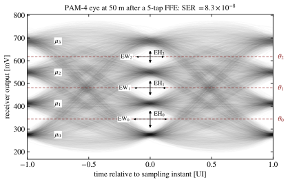
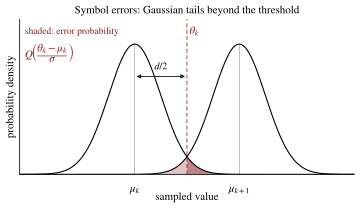

## What it models

The PAM-4/NRZ analyzer (node kind `pam4_analyzer`) measures the electrical signal at its input with a simple, **unequalized** slicer: level statistics, eye heights and widths, and symbol/bit error ratios. It observes only (monitor inputs) and produces a report. The same analysis handles PAM-4 ($M = 4$ levels, 3 thresholds) and NRZ ($M = 2$, one threshold); the nodes take $M$ from the reference symbol stream, the Python function `lightstone.analyze` from its `levels` argument or the symbols.

Inputs: `in` (electrical) and `ref`, the transmitted symbols from the pattern source (`prbs-pattern.md`), used for alignment and for counting errors. Equalized metrics: put an `ffe` node in front (`ffe.md`). The eye picture itself is the `eye_diagram` node (`eye-diagram.md`).

**SER method**: while the input's noise is still exactly Gaussian (`gaussian_exact`, all blocks after the noise sources linear, `receiver-output.md`), the analyzer reports the semi-analytic SER below. After a nonlinear block it reports the counted SER, with resolution $1/N_\text{sym}$ ($N_\text{sym}$: the number of simulated symbols), and says so (`ser_method`, `ser_resolution`).

*Figure 1. The quantities of this page on a simulated eye (50 m, after a 5-tap FFE so that all three eyes are open, SER 8.3 × 10⁻⁸). μ₀…μ₃ are the level means at the sampling instant (t = 0), θ₀…θ₂ the thresholds halfway between them (θ_k between μ_k and μ_{k+1}). EH_k (vertical arrows) is the eye height at the 10⁻³ contour; EW_k (horizontal arrows) the eye width at θ_k. Generated by `scripts/make_figures.py`.*

## Equations

**Alignment**: the integer delay comes from the circular cross-correlation with the known symbol sequence. Fractional sampling phases use Catmull–Rom cubic interpolation. The optimal phase minimizes the semi-analytic SER over 64 phases per UI (unit interval, one symbol period).

**Thresholds**: $\theta_k = \tfrac12(\mu_k + \mu_{k+1})$, where $\mu_k$ are the noiseless level means at the optimal phase (without a noiseless waveform, the means of the noisy samples). Levels are numbered $k = 0 \dots M-1$ from the lowest. The decision threshold $\theta_k$ ($k = 0 \dots M-2$) separates level $k$ from level $k+1$. Levels and thresholds are in the units of the input waveform (V, A or W).

**Semi-analytic SER** (`eq:pam4-ser-semi-analytic`). This is the primary estimate. It includes ISI exactly and assumes Gaussian noise:

$$\mathrm{SER} = \frac1N\sum_n\left[Q\!\left(\frac{y_{0,n} - \theta_{k_n-1}}{\sigma_n}\right) + Q\!\left(\frac{\theta_{k_n} - y_{0,n}}{\sigma_n}\right)\right]$$

Here $N$ is the number of analyzed symbols and $n$ the symbol index. $k_n$ is the transmitted level of symbol $n$, $y_{0,n}$ its noiseless sample at the optimal phase and $\sigma_n$ the RMS noise at that sample (from the noise model σ(t)). The first term is the probability that noise pushes the sample below its lower threshold, the second above its upper threshold.

Missing thresholds for the outer levels are dropped, and $Q(x) = \tfrac12\,\mathrm{erfc}(x/\sqrt2)$ is the Gaussian tail function: the probability that a standard normal variable exceeds $x$ ($\mathrm{erfc}$ is the complementary error function).

**Level-Gaussian SER** (`eq:pam4-ser-gaussian`), with ISI lumped into $\sigma_k$:

$$\mathrm{SER}_G = \frac1M\sum_k\left[Q\!\left(\frac{\hat\mu_k - \theta_{k-1}}{\hat\sigma_k}\right) + Q\!\left(\frac{\theta_k - \hat\mu_k}{\hat\sigma_k}\right)\right]$$

Here $\hat\mu_k$ and $\hat\sigma_k$ are the mean and standard deviation of the noisy samples of level $k$ at the optimal phase (not the noiseless $\mu_k$ of the thresholds), and the sum runs over the $M$ levels $k$. Each level is treated as one Gaussian.

For ideal equally spaced levels with spacing $d$ (the distance between adjacent level means) and the same noise standard deviation $\sigma$ on every level, this reduces to $\mathrm{SER} = \tfrac{2(M-1)}{M}\,Q\!\left(\tfrac{d}{2\sigma}\right)$: $\tfrac32 Q$ for PAM-4, $Q$ for NRZ.

**BER** $\approx$ SER/2 for Gray-coded PAM-4 (a symbol error almost always flips one of its two bits); BER = SER for NRZ.

**Reading the numbers: pre-FEC.** SER and BER are the raw error ratios at the slicer, *before* forward error correction. 50G/100G-per-lane PAM-4 Ethernet always runs Reed–Solomon RS(544,514) "KP4" FEC, and its optical PMDs are specified for a pre-FEC BER of at most $2.4\times10^{-4}$ (IEEE 802.3, e.g. Clauses 138 and 167); the FEC brings that down to the frame loss ratio the standard requires. A PAM-4 link with BER $10^{-7}$ is therefore about three orders of magnitude better than needed. It is not comparable with the $10^{-12}$ of NRZ links without FEC (e.g. 10GBASE-SR). The editor labels the PAM-4 SER *pre-FEC* and shows the margin to this limit, $2.4\times10^{-4}/\mathrm{BER}$ ("KP4 2.4e-4: OK ×600"; "FAIL ×3 over" above the limit; a "+" when the BER is only an upper bound). For NRZ no FEC is assumed and no margin is shown.

**Receiver clock jitter** (`eq:rx-clock-jitter`, option `clock_rj_rms_ui`, default 0). Random jitter $\sigma_\text{clk}$ (in UI) of the sampling instant adds the slope of the noiseless waveform at the sampling instant:

$$\sigma_\text{tot}^2(t) = \sigma^2(t) + \big(y_0'(t)\,\sigma_\text{clk}\big)^2$$

$y_0'$ is computed spectrally. Here $\sigma_\text{tot}(t)$ is the total noise standard deviation at sampling instant $t$, $\sigma(t)$ the standard deviation of all other noise (including TX RJ), $y_0(t)$ the noiseless received waveform and $y_0'$ its derivative per UI, so $y_0'\,\sigma_\text{clk}$ is in the units of $y_0$. Only the semi-analytic SER uses $\sigma_\text{tot}$. It is not in the noisy waveform, so eye height, eye width and the counted SER do not include it; TDECQ does not include it either, as in the standard. Transmitter jitter is part of the signal itself (`driver.md`).

**Eye height** (`eq:pam4-eye-height`): $EH_k = q_{p}(\text{level }k{+}1) - q_{1-p}(\text{level }k)$, with empirical quantiles of the noisy samples and $p = 10^{-3}$. $EH_k$ is the vertical opening of eye $k$ (between levels $k$ and $k+1$) in the units of the input waveform. $q_p(\text{level }k)$ is the value below which a fraction $p$ of the samples of level $k$ lie, so $q_p(\text{level }k{+}1)$ is the lower edge of the upper level and $q_{1-p}(\text{level }k)$ the upper edge of the lower level. $p$ is the probability contour of the eye. A negative $EH_k$ means the eye is closed. The **eye width** $EW_k$ (in UI) is the contiguous phase range around the optimum where the eye stays open at $\theta_k$, i.e. the lower edge of level $k+1$ stays above $\theta_k$ and the upper edge of level $k$ stays below it.

*Figure 2. Origin of the SER formulas. With Gaussian noise of standard deviation σ, a sample of level k is decided wrongly if it falls beyond θ_k; the probability is the shaded tail Q((θ_k − μ_k)/σ), and likewise from the other side. The semi-analytic SER (`eq:pam4-ser-semi-analytic`) evaluates these tails for every symbol with its own noiseless value and σ, so intersymbol interference is included exactly. Schematic.*

## Assumptions & limits

- **No equalizer** in the analysis itself. Real 50G/100G-per-lane receivers equalize: analyze after an `ffe` node, or use TDECQ for an equalized figure of merit.
- Counted errors are limited by the pattern length (8191 symbols per period). The semi-analytic SER extends far below that.
- The semi-analytic SER drops terms with $Q$ arguments above 9, so it cannot show values below $2\,Q(9) \approx 2.3\times10^{-19}$ (at most two threshold terms per symbol, each below $Q(9)$). The `pam4_analyzer` report gives this floor (`ser_floor`) and the RMS of σ(t) (`noise_rms`), where σ(t) is the RMS noise of the waveform versus time; the editor shows an SER of 0 as `< 2.3e-19`, or as `0 (no noise)` when σ = 0, together with the worst-pair Q-factor (`q_min`).
- Receiver clock jitter enters only the semi-analytic SER (first order in the slope, like the transmitter's random jitter).
- Empirical $10^{-3}$ quantiles from ~2048 samples per level are statistically noisy. Increase `tx.pattern_periods` for stable EH/EW.

## Validation

- **V11**: a noise-free back-to-back signal gives exact levels, EH equal to the level spacing, and zero errors.
- **V12**: with known Gaussian noise, the semi-analytic SER equals $\tfrac32 Q(d/2\sigma)$ (to 10⁻⁴), and the counted and level-Gaussian SER match to < 5 %.
- NRZ unit tests: noise-free back-to-back gives two exact levels, one eye of the full swing and SER = 0; with Gaussian noise the SER equals $Q(d/2\sigma)$ (to 10⁻³) and BER = SER.
- **V16b** (`test_v16_jitter.py`): receiver clock RJ raises the semi-analytic SER of a noise-limited NRZ link; the slope formula is exact for a sine (unit test `clock_jitter_slope_noise`).
- The `pam4_analyzer` node gives the same result as the analysis function applied to the lane results (SER and eye heights identical); after TIA clipping it switches to the counted SER (G6).
- **V14a** (docs/validation.md, Section 2) uses the NRZ eye to compare the eye closure vs. length with the IEEE 802.3ae link model.
