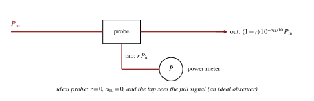

## What it models

An inline optical tap (node kind `probe`). Its output `out` continues the signal, and `tap` feeds instruments or analyzers. An ideal probe (default) observes without taking any light; a realistic probe takes the tapped power from the through path and adds an insertion loss, as a real tap coupler does.

*Figure 1. A realistic probe passes (1 − r)·10^(−α_IL/10) of the power and taps r of it, here to a power meter (`eq:probe`). An ideal probe removes nothing: both outputs are the input signal. Schematic.*

## Equations

**Ideal probe**: `out` and `tap` are the input signal itself; nothing is removed.

**Realistic probe** (`eq:probe`), tap ratio $r$ and through-path insertion loss $\alpha_\text{IL}$:

$$P_\text{out}(t) = (1 - r)\,10^{-\alpha_\text{IL}/10}\,P_\text{in}(t),\qquad P_\text{tap}(t) = r\,P_\text{in}(t)$$

Here $P_\text{in}(t)$ is the optical input power (W) at time $t$, $P_\text{out}(t)$ the power at the through output `out`, and $P_\text{tap}(t)$ the power at `tap`. The tap ratio $r$ (dimensionless, 0 … 1) is the share of the input sent to `tap`. The insertion loss $\alpha_\text{IL}$ (dB) acts on the through path only; the tap output carries no insertion loss.

## Assumptions & limits

- Mode- and polarization-independent tap.
- Monitor inputs of analyzers and instruments are ideal observers already; use a realistic probe to account for the power a real tap takes.

## Parameters

| Name | Symbol | Unit | Default | Range |
|---|---|---|---|---|
| `realistic` | — | — | false | — |
| `tap_ratio` | $r$ | — | 0.02 | 0 … 1 |
| `insertion_loss_db` | $\alpha_\text{IL}$ | dB | 0 | ≥ 0 |

## Validation

- **G4**: an ideal probe leaves the through signal bit-identical; a realistic probe reduces it by exactly its through transmission, and the tap carries the tap ratio (to 10⁻¹²).
