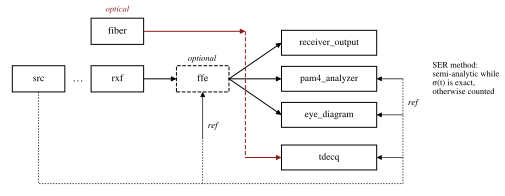

## What it models

The receiver output (node kind `receiver_output`) is the end of the analog receiver: the point where the electrical signal at its input, kept until then as a spectrum plus a list of noise terms, becomes explicit waveforms. It makes no decision: it does not compare against thresholds and outputs no symbols. It produces:

- the **noiseless** waveform,
- one **noisy** realization (what a scope would show),
- **σ(t)**, the exact noise standard deviation at every sample,
- `gaussian_exact`: whether the noise is still exactly Gaussian.

If the noise has passed a nonlinear block, it warns that σ(t) does not describe it and the SER must be counted. Its node display shows the mean and the RMS noise. Its input is a monitor input; it has no outputs. The lane presets end with it (node id `rx`), and `Graph.receiver()` reads it. Thresholds, sampling phase and SER are computed by the analyzer (`pam4-analysis.md`). Until v0.12 this kind was called `decision` (node id `dec`); graphs saved with the old name still load.

*Figure 1. Where the receiver output sits: at the end of the electrical chain (here after an `ffe`), next to the analysis nodes that observe the same signal. Schematic.*

## Equations

**Materialization** (`eq:materialize`): the noiseless waveform is the inverse FFT of the signal's spectrum (base × accumulated filter × gain); the noisy waveform adds one realization of every noise term, each drawn at its point of generation and filtered since; σ(t) follows from the noise description (signal-spec 5):

$$\sigma^2(t) = \sum_\text{terms} g^2\thinspace\tfrac{f_s}{2}\thinspace(h^2 * S)(t)$$

Here the sum runs over the signal's noise terms. For each term, $S(t)$ is its one-sided PSD at the point of generation (constant or time-varying), $h$ the discrete impulse response of the filters it has passed since then, $h^2$ its squared samples, and $g$ its scalar gain since then. $f_s$ is the sampling rate in Hz (white noise of PSD $S$ has per-sample variance $S f_s/2$), and $*$ is the circular convolution over the time grid. σ(t) is the noise standard deviation in the signal's unit (V after the TIA). Noise that has passed a nonlinear block is carried only as an explicit realization; it is part of the noisy waveform but adds nothing to σ(t), and `gaussian_exact` is false.

## Assumptions & limits

- Not a slicer with its own thresholds and data output; a real decision circuit (for an error counter like a BERT) is a possible later addition.
- One noise realization per run; σ(t) describes the noise statistics exactly while `gaussian_exact` holds.

## Parameters

None.

## Validation

- **G6**: after TIA clipping, `gaussian_exact` is false and the node warns; with inactive clipping the counted SER from its noisy waveform matches the semi-analytic SER within its statistical error.
- The simulated noise (realization) matches σ(t) to < 2 % at 0, 50 and 150 m (Python test).
