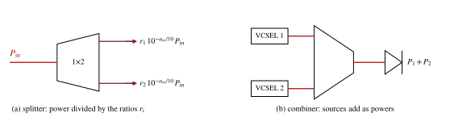

## What it models

A passive optical power splitter (node kind `splitter`): it divides the light at its input among several outputs (`out0` … `outN−1`), mode- and polarization-independently. To send light to two components, a splitter is required, because light cannot be copied (signal-spec 7).

*Figure 1. (a) A 1×2 splitter divides the input power by the ratios r₁, r₂, reduced by the excess loss α_ex (`eq:splitter`). (b), for comparison, the combiner (`combiner.md`). Schematic.*

## Equations

**Splitter** (`eq:splitter`):

$$P_i(t) = r_i\thinspace10^{-\alpha_\text{ex}/10}\thinspace P_\text{in}(t),\qquad \sum_i r_i \le 1$$

Here $P_\text{in}(t)$ is the optical input power (W) at time $t$ and $P_i(t)$ the power at output $i$ ($i$ counts the outputs). The split ratio $r_i$ (dimensionless, ≥ 0) is the share of the input power sent to output $i$; a sum below 1 means extra loss. The excess loss $\alpha_\text{ex}$ (dB) applies equally to every output.

Every output carries the input's source contributions with scaled mode-bin weights, so the signals stay lazy; the noise carried with them is scaled the same way.

## Assumptions & limits

- Same transmission for all modes and polarizations. Real multimode couplers can be mode-selective, which changes the modal bandwidth.
- No phase: at the `Field` level a coupler is described by an S-matrix with phases (signal-spec 11.2), not modeled yet.
- No reflections, no wavelength dependence.

## Parameters

| Name | Symbol | Unit | Default | Range |
|---|---|---|---|---|
| `ratios` | $r_i$ | — | [0.5, 0.5] | ≥ 2 outputs, $r_i \ge 0$, Σ ≤ 1 |
| `excess_loss_db` | $\alpha_\text{ex}$ | dB | 0 | ≥ 0 |

## Validation

- **G3**: output powers sum to $\sum_i r_i\thinspace10^{-\alpha_\text{ex}/10} \times$ input power to 10⁻¹², with the set ratio between outputs.
