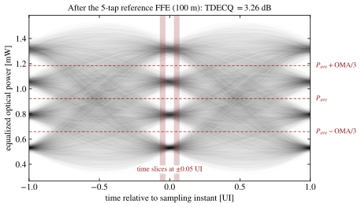

## What it models

Transmitter and dispersion eye closure for PAM-4 (TDECQ), the IEEE 802.3 figure of merit for PAM-4 optical transmitters. It is the dB ratio of the noise an ideal transmitter could tolerate to the noise this signal can tolerate, measured after a reference receiver and a 5-tap reference equalizer (the number of taps is an option; 1 = no equalizer).

## Equations

**Input and reference receiver** (`eq:tdecq-input`): the node takes the optical signal at its input, collects all light, and filters it with its own reference receiver, a 4th-order Bessel–Thomson low-pass (`bessel-thomson.md`) at $f_\text{3dB} = 0.5\times$ baud. Transmitter noise (RIN, transmitter jitter) is part of the waveform; receiver noise is not:

$$P_\text{ref}(t) = \mathcal{F}^{-1}\Big\lbrace H_\text{BT}(f)\sum_\text{sources}\big(\hat P_\text{tx}(f) + \hat P_\text{RIN}(f) + \hat P_\text{J}(f)\big)H_\text{ch}(f)\Big\rbrace$$

Here $P_\text{ref}(t)$ is the filtered optical power in W and $\mathcal{F}^{-1}$ the inverse Fourier transform (an inverse FFT on the time grid). $H_\text{BT}(f)$ is the reference receiver, $f$ the frequency in Hz, $f_\text{3dB}$ the filter's −3 dB frequency in Hz and baud the symbol rate in Bd. The sum runs over the optical sources. For each source, $\hat P_\text{tx}(f)$ is the spectrum of its transmitted power, $\hat P_\text{RIN}(f)$ the spectrum of its RIN realization (`vcsel.md`), $\hat P_\text{J}(f)$ that of its transmitter-jitter noise (zero without jitter, `driver.md`), and $H_\text{ch}(f)$ the power transfer function of its channel from the transmitter to the node, with all light collected.

**Thresholds** (fixed): $P_\text{ave} - \mathrm{OMA_{outer}}/3,\ P_\text{ave},\ P_\text{ave} + \mathrm{OMA_{outer}}/3$. Here $P_\text{ave}$ is the average optical power of the waveform in W and $\mathrm{OMA_{outer}}$ the outer optical modulation amplitude in W (the power difference between levels 3 and 0). As in IEEE 802.3 121.8.4, $P_3$ is the mean over the central 2 UI of a run of 7 threes and $P_0$ the mean over the central 2 UI of a run of 6 zeros (PRBS13Q has both); for patterns without such runs, the mid-symbol values of settled runs are used. The three thresholds separate the four PAM-4 levels.

**Equalizer** (`eq:ffe`): $L$ T-spaced taps (option `ffe_taps`, default 5 as in IEEE 802.3; odd, 1 … 15; $L = 1$ is no equalization, the single tap is then 1) with the middle tap as main cursor and $\sum c_i = 1$, where $c_i$ ($i = 0 \dots L-1$) are the dimensionless tap weights and $T$ is the symbol period. The constraint keeps the DC gain at 1. Its noise enhancement for noise shaped by the reference receiver is

$$C_\text{eq} = \sqrt{\frac{\int |H_\text{ref}(f)\thinspace H_\text{FFE}(f)|^2 df}{\int |H_\text{ref}(f)|^2 df}}$$

Here $f$ is the frequency in Hz, $H_\text{ref}(f)$ the transfer function of the reference receiver, and $H_\text{FFE}(f)$ that of the equalizer (`docs/model/ffe.md`). $C_\text{eq}$ (dimensionless) is the factor by which the equalizer scales the RMS of the receiver-shaped noise. Both integrals run from 0 to 6 × baud.

**σ_G**: the largest Gaussian noise at the equalizer output for which the SER (symbol error ratio) in both time slices (eye center ± 0.05 UI, width 0.04 UI, sampled at 16 uniformly spaced times) is ≤ 4.8 × 10⁻⁴. σ_G is a standard deviation in W; UI is the unit interval (one symbol period). The SER of a slice is the mean over its samples $v$ of the probability that noise of RMS σ_G moves $v$ across a threshold into a wrong level. The eye center is the phase (1/64 UI grid) that minimizes TDECQ, searched within ±1/16 UI of two candidates: the phase of minimum MMSE and the standard's center, the mean crossing time of $P_\text{ave}$ plus 0.5 UI.

**TDECQ** (`eq:tdecq`):

$$\mathrm{TDECQ} = 10\log_{10}\frac{\mathrm{OMA_{outer}} / (6\thinspace Q_t)}{\sigma_G / C_\text{eq}},\qquad Q_t = 3.414\quad\left(\tfrac32 Q(Q_t) = 4.8\times10^{-4}\right)$$

Here $\mathrm{OMA_{outer}}$ is the outer optical modulation amplitude in W, $Q(x)$ the Gaussian tail function (the probability that a standard normal variable exceeds $x$), and $Q_t$ the dimensionless Q-factor at which an ideal PAM-4 eye reaches the target SER. $\mathrm{OMA_{outer}}/(6\thinspace Q_t)$ is the noise standard deviation an ideal transmitter tolerates at the target SER (half the level spacing $\mathrm{OMA_{outer}}/3$, divided by $Q_t$). $\sigma_G / C_\text{eq}$ is the tolerated noise of this signal, referred back to the equalizer input. TDECQ is in dB.

An ideal, ISI-free transmitter gives 0 dB.

Graph node: `tdecq` with inputs `in` (optical, monitor) and `ref` (the transmitted symbols from the pattern source, `prbs-pattern.md`; PRBS13Q or SSPRQ). Option `ffe_taps` (default 5). A measured scope waveform can be analyzed with the same function from Python (`measured-data.md`).

*Figure 1. What TDECQ looks at: the optical waveform after the reference receiver and the 5-tap reference FFE (reference link, 100 m). The two shaded time slices, each 0.04 UI wide at ±0.05 UI around the eye center, and the fixed thresholds P_ave and P_ave ± OMA/3. σ_G is the largest added Gaussian noise for which the SER in both slices stays ≤ 4.8 × 10⁻⁴. Here TDECQ = 3.26 dB. Generated by `scripts/make_figures.py`.*

## Assumptions & limits

The implementation follows the IEEE 802.3 method (121.8.5.3, with the histogram shift of D3.4) with the simplifications below. Validation V19 sizes each one against an independent implementation of the standard's text; together, Lightstone is 0.02–0.09 dB **conservative** (higher TDECQ) on the reference link from 0 to 150 m with and without jitter. It has not been compared with a commercial scope.

- **Taps.** The FFE taps are the constrained MMSE solution, not the taps that minimize TDECQ for the added noise (king_02_0217_smf). With the phase search, this costs 0.02–0.09 dB (most at 150 m, TDECQ ≈ 5.8 dB). The standard's wording is ambiguous between minimizing TDECQ and maximizing σ_G at the equalizer output; the second gives 0.04–0.05 dB more TDECQ on the same links.
- **Eye center.** Searched over the phase (see σ_G) instead of taking the mean crossing time and optionally shifting the histogram pair. A fixed crossing-based center with MMSE taps can be far off: +1.1 dB at 150 m, so the search matters for MMSE taps.
- **Histograms per symbol.** The pattern tells which level each sample belongs to. The standard's symbol-agnostic histograms give the same TDECQ while no sample lies beyond its threshold. When samples do (strong RIN, TDECQ far above any limit), Lightstone counts them as errors and reports a closed eye (`tdecq_db = None`), while the standard method returns a finite value (V19: 9.9 dB at RIN −135 dB/Hz, 100 m).
- **OMA_outer** is measured on the PRBS13Q waveform itself, which 121.8.4 allows. Before V19 it used mid-symbol values of settled runs; that gave 0.85–1.2 % less OMA and 0.10–0.13 dB less TDECQ. `oma_outer` can be given as an option (for example from a separate square-wave measurement).
- **Window sampling.** 16 times per 0.04 UI window, converged to ~0.003 dB. Fewer points matter: 3 points within ±1/64 UI changed TDECQ by up to 0.05 dB at 150 m.
- No threshold adjustment and no scope noise $\sigma_S$ (the RMS noise of the measuring oscilloscope).
- The node collects all light (lens-coupled reference receiver), regardless of a photodiode's `detector_radius` elsewhere in the graph. Receiver clock jitter is not included, as in the standard.

## Validation

- **V13**: TDECQ of an ideal PAM-4 signal is 0 dB (< 0.1 dB).
- The `tdecq` node gives the same TDECQ as the analysis function applied to the lane's reference-receiver waveform (to 10⁻⁹ dB).
- More reference-receiver bandwidth limitation gives monotonically higher TDECQ.
- **V14b**: TDECQ at 53.125 GBd over worst-case OM4 agrees with TDECQ through the IEEE 802.3db fiber emulation filter (Table 167-12) within 0.15 dB with matched dispersion (docs/validation.md, Section 3). Both sides use this implementation; it checks the channel, not the TDECQ algorithm.
- `ffe_taps` (`tdecq.rs`, `tests/python/test_measured.py`): with 1 tap the tap is 1 and $C_\text{eq}$ = 0 dB; on an ISI-limited signal 1 tap gives more TDECQ than 5, and 9 taps no more than 5 (+0.02 dB); even counts are rejected. TDECQ of measured waveforms: `measured-data.md`.
- **V19** (`tests/python/test_v19_tdecq.py`): an independent TDECQ in `reference/lightstone_ref` (NumPy/SciPy), written from the standard's text: symbol-agnostic histograms, center from the mean crossing time with the 0.1 UI histogram pair shifted for minimum TDECQ, taps optimized for minimum TDECQ (Nelder–Mead), OMA_outer per 121.8.4, band-limited interpolation, and $C_\text{eq}$ from the noise autocorrelation at symbol lags instead of the frequency integral. No public IEEE reference code or waveforms exist to compare with.
  - Analytic: ISI-free PAM-4 with Gaussian noise of RMS $\sigma_s$ has $\mathrm{TDECQ} = 10\log_{10}\big(\sigma_\text{ideal}/\sqrt{\sigma_\text{ideal}^2 - \sigma_s^2}\big)$, $\sigma_\text{ideal} = \mathrm{OMA_{outer}}/(6Q_t)$. Both implementations agree within 0.02 dB for $\sigma_s/\sigma_\text{ideal}$ = 0 … 0.7.
  - Mechanics: with Lightstone's taps, phase and per-symbol histograms the oracle gives Lightstone's TDECQ within 0.02 dB (measured ≤ 0.011 dB), $C_\text{eq}$ within 10⁻⁶ dB, and the same OMA_outer.
  - Method: Lightstone minus the full standard method is +0.05 to +0.06 dB on the reference link at 32 samples/UI (0, 100, 150 m, RJ 0.01 UI); test bound −0.02 … +0.15 dB.
- Not done: comparison with measured TDECQ or a commercial scope (802.3db uses a 9-tap FFE; here the default is 5 taps, and `ffe_taps = 9` is possible).
