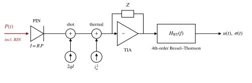

## What it models

The transimpedance amplifier (node kind `tia`) converts the photocurrent at its input into a voltage and adds its own thermal noise. Optionally it clips its output, which makes it nonlinear.

*Figure 1. Where the TIA sits. The photodiode delivers the current I = R·P with shot noise; the TIA adds its input-referred thermal noise (i_n²) and converts the sum to a voltage with the transimpedance Z. The receive filter after it shapes signal and noise alike (`bessel-thomson.md`).*

## Equations

**Gain**: $u(t) = Z\thinspace I(t)$. Here $u(t)$ is the output voltage in V, $Z$ the transimpedance in Ω and $I(t)$ the input current in A. The signal and every noise term at the input are scaled by $Z$; the quantity changes from current to voltage.

**Thermal noise** (`eq:rx-noise`): a white Gaussian current noise at the input with one-sided PSD

$$S_\text{th} = i_n^2$$

Here $S_\text{th}$ is the thermal noise PSD in A²/Hz and $i_n$ the input-referred noise current density in A/√Hz. It is generated with the receiver's seed and, like the input noise, scaled by $Z$.

**Output clipping** (`eq:tia-clip`, optional). With limits $[u_\text{lo}, u_\text{hi}]$:

$$u(t) = \min\mskip-3mu \big(\max\big(Z\thinspace(I(t) + i_\text{noise}(t)),\ u_\text{lo}\big),\ u_\text{hi}\big)$$

applied to the noiseless and to the noisy waveform. Here $u_\text{lo}$ and $u_\text{hi}$ are the lower and upper output limits in V, $I(t)$ the noiseless input current in A and $i_\text{noise}(t)$ the realization of all input noise current (shot, RIN, thermal) in A ($i_\text{noise} = 0$ for the noiseless waveform). The noise arises before the clipper, so after it the noise is no longer Gaussian: σ(t) no longer describes it, and the SER must be counted (Monte Carlo, resolution 1/N_sym, with N_sym the number of simulated symbols). The node warns how many samples were clipped.

## Assumptions & limits

- Thermal noise is white (input-referred). Real TIAs have a noise density that rises with frequency ($f^2$ noise).
- No bandwidth of its own (the receive filter stands for the receiver bandwidth), no offset.
- Nonlinearity only as hard output clipping, not as soft compression.

## Parameters

| Name | Symbol | Unit | Default | Range |
|---|---|---|---|---|
| `transimpedance` (lane: `rx.transimpedance`) | $Z$ | Ω | 1000 | — |
| `noise_density` (lane: `rx.noise_density`) | $i_n$ | A/√Hz | 15 p | 5 … 40 p |
| `thermal_noise` (lane: `rx.thermal_noise`) | — | — | true | — |
| `clip` (graph node only) | $[u_\text{lo}, u_\text{hi}]$ | V | none (linear) | $u_\text{lo} < u_\text{hi}$ |
| `noise_seed` | — | — | from the node | thermal noise random stream |

## Validation

- **V9**: with zero optical input, the output variance after the receive filter equals $Z^2 i_n^2 B_n$ to < 1 % ($B_n$: `bessel-thomson.md`).
- **G6** (clipping): with limits far outside the signal, the counted SER matches the semi-analytic SER of the linear receiver within its statistical error; active clipping raises the SER.
