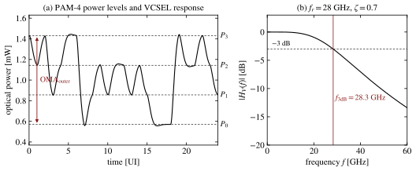

## What it models

An 850 nm vertical-cavity surface-emitting laser, directly modulated by the drive current (node kind `vcsel`). It converts the normalized drive from the driver (`driver.md`) into optical power with M equally spaced levels (4 for PAM-4, 2 for NRZ). Its finite modulation bandwidth rounds the transitions, and its relative intensity noise (RIN) adds random power fluctuations. It also defines the properties of the light that later components need: wavelength and spectral width (chromatic dispersion in the fiber, WDM filters), the near field (which fiber modes get the light, `connector.md`) and the polarization.

## Equations

**Power levels** (`eq:tx-levels`) from the average power $\bar P$ and the outer extinction ratio $ER = P_{M-1}/P_0$:

$$P_0 = \frac{2\bar P}{ER + 1},\qquad P_{M-1} = \frac{2\bar P\thinspace ER}{ER + 1},\qquad P_k = P_0 + \frac{k}{M-1}(P_{M-1} - P_0)$$

$$\mathrm{OMA_{outer}} = P_{M-1} - P_0$$

Here $P_k$ is the optical power (W) of level $k = 0 \dots M-1$, $M$ the number of levels, $\bar P$ the average optical power (W; set in dBm) and $ER$ the linear extinction ratio (set in dB). $\mathrm{OMA_{outer}}$ is the outer optical modulation amplitude (W), the distance between the lowest and the highest level. NRZ and PAM-4 have the same outer levels, average power and OMA.

**Drive to power**: the normalized drive $d(t)$ from the driver (0 for the lowest, 1 for the highest level; $t$ is time in s) gives the optical power

$$P(t) = \max\mskip-3mu \Big(0,\ \mathcal{F}^{-1}\big\lbrace H_V(f)\thinspace\mathcal{F}\lbrace P_0 + (P_{M-1} - P_0)\thinspace d\rbrace(f)\big\rbrace(t)\Big)$$

Here $P(t)$ is the transmitted optical power (W), $\mathcal{F}$ and $\mathcal{F}^{-1}$ are the Fourier transform and its inverse (FFTs on the time grid), and $H_V(f)$ is the modulation response below. Power cannot be negative, so it is clipped at 0 W; with the default parameters this never happens, but it makes the node formally nonlinear. Noise terms of the drive (transmitter jitter, `driver.md`) are converted to optical power noise with $(P_{M-1} - P_0)\thinspace H_V(f)$ and then carried like RIN.

**Modulation response** (`eq:vcsel-response`), applied to the power waveform:

$$H_V(f) = \frac{1}{1 - (f/f_r)^2 + j\thinspace2\zeta\thinspace f/f_r}$$

Here $H_V(f)$ is the complex gain of the power waveform at modulation frequency $f$ (Hz, 1 at DC), $j$ the imaginary unit, $f_r$ the relaxation-oscillation resonance frequency (Hz) and $\zeta$ the dimensionless damping factor, which sets how much the response peaks near $f_r$. The defaults ($f_r$ = 28 GHz, $\zeta$ = 0.7) give a −3 dB bandwidth of 28.3 GHz.

**RIN** (`eq:vcsel-rin`): Gaussian power noise with one-sided PSD

$$S_P(t) = \mathrm{RIN}\cdot P(t)^2,$$

white up to $f_s/2$. Here $S_P$ is the power spectral density of the noise (W²/Hz), $\mathrm{RIN}$ the relative intensity noise as a linear value (1/Hz; set in dB/Hz), $P(t)$ the noiseless optical power after the modulation response (W), and $f_s$ the sample rate of the grid (Hz; baud × samples per symbol). The strength follows the power, so the noise is larger on the high levels. The VCSEL draws one realization with its own seed; from the photodiode on it is carried as a noise term (`pin.md`), so σ(t) stays exact.

**Source properties** handed on with the optical signal:

- Centre wavelength $\lambda_0$ and RMS spectral width $\sigma_\lambda$ (Gaussian spectrum). They set the fiber's modes and chromatic broadening (`custom-fiber.md`), the wavelength-dependent attenuation and responsivity, and the weighting in WDM filters (`bandpass-filter.md`, `wdm-mux.md`, `wdm-demux.md`). The spectral width also sets the coherence time used in the photodiode's validity check.
- Near field: an incoherent mix of the lowest $Q$ Laguerre–Gauss mode groups with waist $w$ (below); how it couples into the fiber modes is described in `connector.md`.
- Polarization: a normalized Stokes vector, unpolarized by default (signal-spec 8).

**VCSEL near field** (`eq:launch-lg`): an incoherent, equal-power mixture of the lowest $Q$ Laguerre–Gauss mode groups ($2p + l = q - 1$, $q = 1 \dots Q$):

$$u_{pl}(\rho,\phi) = \frac{C_{pl}}{w}\left(\frac{\sqrt2\rho}{w}\right)^{l} L_p^{l}\mskip-3mu \left(\frac{2\rho^2}{w^2}\right) e^{-\rho^2/w^2}\thinspace\lbrace\cos,\sin\rbrace(l\phi)$$

Each mode is normalized to unit power, and $(\rho, \phi)$ are measured from the beam center (at the connector's offset $\Delta x$, `connector.md`). Here $q$ is the mode group index, $Q$ the number of groups, $p \ge 0$ the radial and $l \ge 0$ the azimuthal mode index, $\rho$ the radial distance (m) and $\phi$ the azimuth angle (rad), $w$ the beam radius (m, the radius where the fundamental field falls to $1/e$), $L_p^{l}$ the generalized Laguerre polynomial, and $C_{pl}$ the dimensionless constant that gives the mode unit power. $\lbrace\cos,\sin\rbrace(l\phi)$ means that each mode with $l > 0$ comes in a cos and a sin orientation, counted as two modes; $l = 0$ has only one.

*Figure 1. (a) Transmitted optical power over 24 symbols at the default settings (0 dBm, ER 4 dB): four levels from 0.57 to 1.43 mW, OMA_outer = 0.86 mW. The finite VCSEL bandwidth rounds the transitions and causes a small overshoot. (b) Magnitude of the second-order response (`eq:vcsel-response`), −3 dB at 28.3 GHz. Generated by `scripts/make_figures.py`.*

## Assumptions & limits

- Linear small-signal model: no thermal rollover, no gain compression, no level-dependent bandwidth. The PAM-4 levels stay equally spaced.
- No frequency chirp. Chromatic effects use the static RMS spectral width (see the fiber model).
- RIN is white and has no relaxation-oscillation peak.
- The transverse modes of the near field are equally excited and do not depend on the current; the spectrum is one Gaussian line, without the individual mode lines of a real multimode VCSEL.

## Parameters

| Name | Symbol | Unit | Default | Range |
|---|---|---|---|---|
| `p_avg_dbm` (lane: `tx.p_avg_dbm`) | $\bar P$ | dBm | 0 | −10 … 5 |
| `er_db` (lane: `tx.er_db`) | $ER$ | dB | 4 | 2 … 8 |
| `vcsel.resonance_freq` | $f_r$ | Hz | 28 G | 10 … 40 G |
| `vcsel.damping` | $\zeta$ | — | 0.7 | 0.3 … 1.5 |
| `vcsel.rin_db_hz` | RIN | dB/Hz | −140 | −155 … −125 |
| `rin_enabled` (lane: `rx.rin_noise`) | — | — | true | — |
| `vcsel.wavelength` | $\lambda_0$ | m | 850 n | 840 … 953 n (SWDM: 850, 880, 910, 940 n) |
| `vcsel.spectral_width_rms` | $\sigma_\lambda$ | m | 0.4 n | 0 … 0.65 n |
| `beam_radius` (lane: `launch.beam_radius`) | $w$ | m | 4 µ | 2 … 10 µ |
| `vcsel_mode_groups` (lane: `launch.vcsel_mode_groups`) | $Q$ | — | 4 | 1 … 8 |
| `stokes` | — | — | [1, 0, 0, 0] (unpolarized) | normalized Stokes vector |
| `seed` | — | — | from the node | RIN random stream |

The number of levels $M$ comes from the pattern source (`prbs-pattern.md`) through the driver.

## Validation

- Unit tests (`tx.rs`): the level mapping has the set ER and average power, equally spaced levels; the second-order response has unit DC gain and a plausible −3 dB bandwidth.
- **V15**: Rust and NumPy reference transmitter waveforms agree to < 10⁻⁹ (the transmitter is compared directly; the 10⁻⁷ tolerance in docs/validation.md, Section 1 applies to the stages after the fiber).
- Unit test: the NRZ levels have the same outer levels as PAM-4.
- The transmitter's end-to-end effect is covered by the link tests (R1 golden snapshot) and, for NRZ, by **V14a** (eye closure vs. length against the IEEE 802.3ae link model, docs/validation.md, Section 2).
