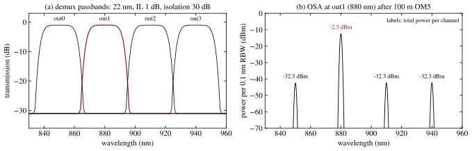

## What it models

A WDM demultiplexer (node kind `wdm_demux`): one input, N outputs (`out0` … `outN−1`), one per wavelength channel. Each output carries **every** source contribution at the input, weighted by that channel's passband. The leakage of the other channels through a port is real crosstalk at the receiver behind it: those sources arrive with their own data, delays and noise.

*Figure 1. (a) The four ports of the default SWDM4 demux: 22 nm wide (−3 dB), order 3, insertion loss 1 dB, floor 30 dB below the peak. (b) Four VCSELs (0 dBm each) through the mux, 100 m of OM5 and the demux, seen by the optical spectrum analyzer at `out1`. The 880 nm channel arrives with −2.3 dBm (mux and demux loss, 0.3 dB fiber); the three others leak through at −32.3 dBm. Generated by `scripts/make_figures.py`.*

## Equations

**Per output port** $k$:

$$P_k(t) = \sum_c T_k(\lambda_c)\thinspace P_c(t)$$

Here $P_k(t)$ is the optical power (W) at output `out`$k$, $c$ runs over the source contributions at the input, $\lambda_c$ is the centre wavelength of source $c$, $P_c(t)$ its power at the input (W), and $T_k$ the passband of `eq:wdm-passband` (`bandpass-filter.md`) centred at the channel wavelength $\lambda_k$ (`channels`), with the demux's width, order, insertion loss and isolation. Each contribution stays separate and keeps its noise terms; the demux is linear, so σ(t) and the semi-analytic SER stay exact at every output.

## Assumptions & limits

- Centre-wavelength weighting, no filter dispersion, no polarization dependence and no reflections, as for the bandpass filter (`bandpass-filter.md`).
- The default values are typical of SWDM4 thin-film demux parts, not from a standard.

## Parameters

| Name | Symbol | Unit | Default | Range |
|---|---|---|---|---|
| `channels` | $\lambda_k$ | m | 850, 880, 910, 940 n | one port each |
| `width` | $w$ | m | 22 n | > 0 |
| `order` | $n$ | — | 3 | 1 … 10 |
| `insertion_loss_db` | IL | dB | 1.0 | ≥ 0 |
| `isolation_db` | ISO | dB | 30 | > 0, or `null` (no floor) |

## Validation

- **V17a** (`graph_tests.rs`): with ideal mux and demux, each output of a 4-VCSEL SWDM4 link over 100 m OM5 equals the single-wavelength link of its channel to 10⁻⁹.
- **V17b**: crosstalk is exact superposition. At port $k$ the noiseless waveform equals $\sum_j T_k(\lambda_j)\thinspace T_j^\text{mux}(\lambda_j)\thinspace y_j(t)$, with $j$ running over the channels, $\lambda_j$ the wavelength of channel $j$, $T_j^\text{mux}$ the passband of mux input $j$, and $y_j$ the single-wavelength waveform of channel $j$ (to 10⁻⁹, isolation 15 dB).
- Example (Python, 8 samples/UI, default filters, 4 channels at 0 dBm, 5-tap FFE per receiver, PAM-4 53.125 GBd): SER per channel 850/880/910/940 nm is 1.0e-6, 2.0e-6, 6.7e-6, 3.5e-5 over 100 m OM4 and 7.6e-7, 3.7e-7, 2.6e-7, 2.3e-7 over 100 m OM5. With 15 dB isolation, OM5: 1.9e-5 … 2.6e-6. These long-wavelength numbers are optimistic: the fiber presets are ideal fibers at the 850 nm minimum (V18, `mmf.md`).
